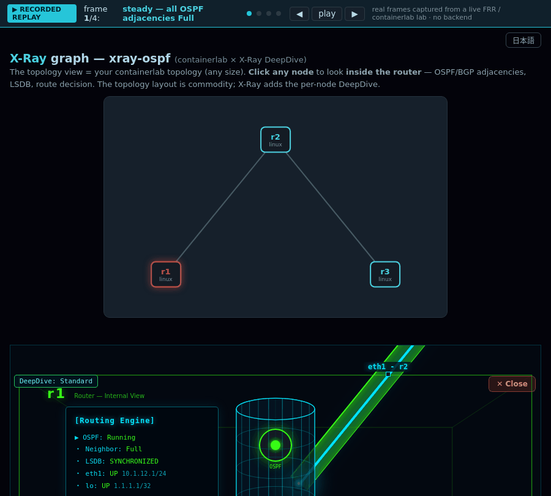
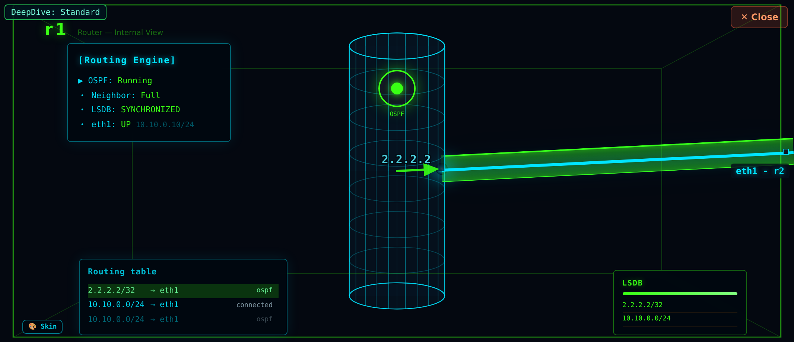
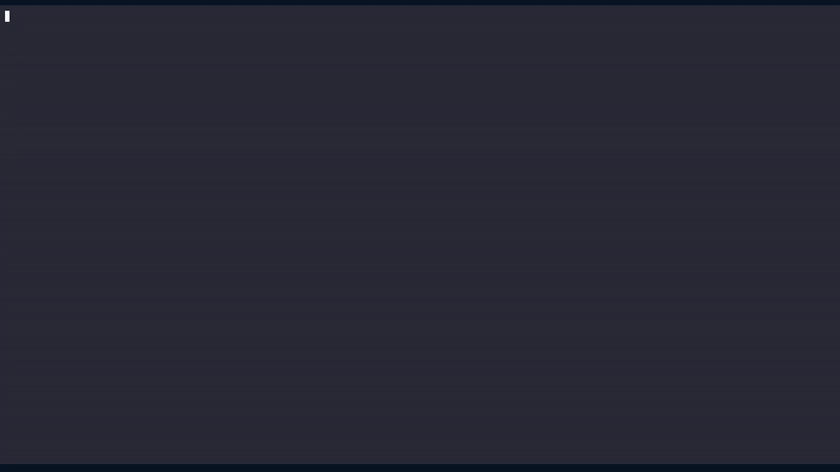
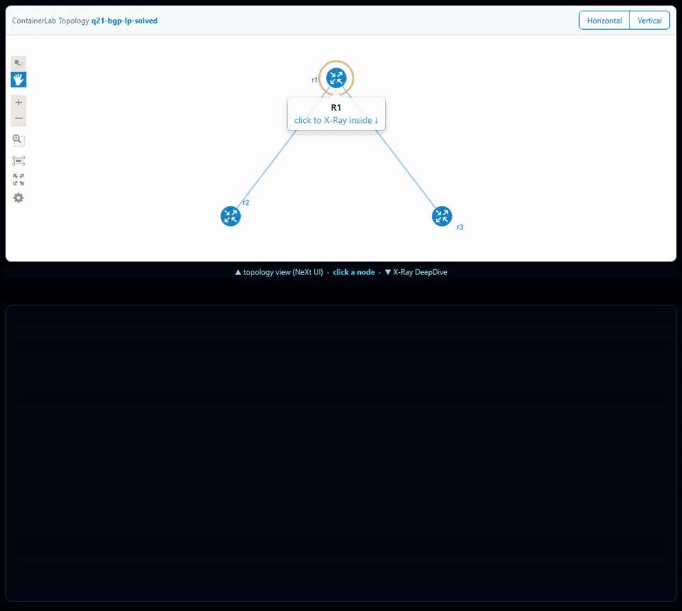
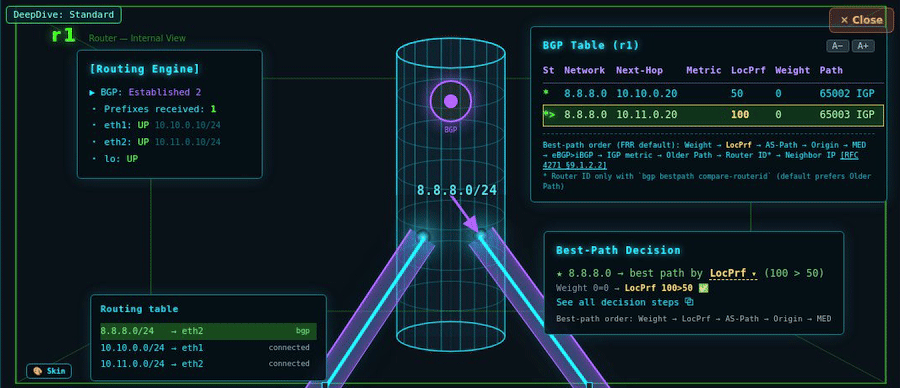
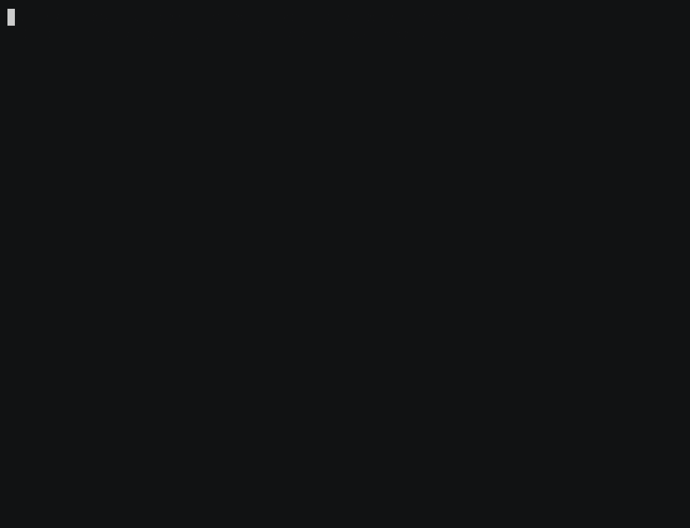

# network-xray

**Why did BGP pick this path?** network-xray shows, for a network lab, which path each router chose, what the other candidates were, and why. It reads the live state of the FRR, Nokia SR Linux and Cisco IOL routers in your containerlab or netlab lab and draws it in the browser.

*English | [日本語](#日本語)*

<!-- nx_readme_entry (2026-10-20) -->


### ▶ [Open the recorded Best-Path Decision demo](https://rclab-dev.github.io/network-xray/demo/index-bgp-lp.html) — no routers needed

Recorded from a real FRR / containerlab lab and replayed in the browser. Three things to look at:
1. Click **r1** to look inside it.
2. In its BGP table, compare the two candidates for `8.8.8.0/24`.
3. Read the **Best-Path Decision** panel: why the winner won (here, Local Preference).

<!-- nx_readme_three_ways (2026-10-28) -->
**Two ways to start:**
1. **Recorded** — the recorded demo above (no routers needed), or a [recorded 30-second video](https://rclab-dev.github.io/network-xray/docs/demo-30s.mp4) (1.4 MB) showing the best path move after one Local Preference change.
2. **Live: your own running containerlab lab** — run in the lab's folder, then open <http://localhost:8600/>:
   ```bash
   docker run --rm -v /var/run/docker.sock:/var/run/docker.sock -v "$(pwd)":/lab:ro -p 127.0.0.1:8600:8600 ghcr.io/rclab-dev/network-xray:1 --topo /lab/<lab>.clab.yml
   ```
   It only runs `show` commands, but the container is given the Docker socket (root-equivalent on the host) — lab machines only. [More](#security-notes)
   You can pin the image as `ghcr.io/rclab-dev/network-xray@sha256:<digest>`; see the [release page](https://github.com/rclab-dev/network-xray/releases/latest).

Using netlab? Add the `tools: network_xray:` declaration and load `docker/netlab-defaults.yml` through `defaults.sources.extra`: [netlab tool](#netlab-tool).

## Other ways to try it

**Live example lab** — clone this repository and run `./xray.sh examples/q21-bgp-lp/q21.clab.yml` ([Quick start](#quick-start-run-a-lab-in-containerlab); `xray.sh` listens on all interfaces and has no login; see the [security notes](#security-notes)).

### ▶ Live lab — GitHub Codespaces

Needs a GitHub login · starts in about 2–3 minutes · runs a real 3-router FRR lab where you can change the config and watch the picture follow.

> **Before you start:** it runs on your own Codespaces quota (delete the codespace when you are done). The page is forwarded on port 8600; Codespaces keeps a forwarded port private to you (signed in to GitHub) unless you make it public — keep it private.

[](https://codespaces.new/rclab-dev/network-xray?quickstart=1)

**Try it in your browser** — the button starts a GitHub Codespace that deploys a 3-router FRR lab with containerlab and opens the X-Ray graph on port 8600 (about 2–3 minutes). Click any router to look inside it; shut an interface (`sudo docker exec clab-q21-bgp-lp-r1 vtysh -c 'conf t' -c 'interface eth2' -c 'shutdown'`) and the picture updates by itself in a few seconds.
- Uses your own Codespaces quota (personal accounts: 120 core-hours/month free; this demo asks for a 4-core machine). **Delete the codespace when you are done.**
- Container-based nodes only (FRR etc.) — Codespaces has no nested virtualization.

**Next:** [your own containerlab lab](#quick-start-run-a-lab-in-containerlab) · [netlab](#netlab-tool) · [what it supports](#scope--maintenance)

**Live hosted lab with hints and explanations:** The same X-Ray runs on RouteCrushLab — [try Q21 as a guest](https://routecrushlab.com/lab/tl/q21?try=guest&lang=en&ref=oss) (no sign-up; the lab is ready in under a minute).

## When to use

- **Use it when** you run **FRR**, **Nokia SR Linux** or **Cisco IOS-XE (IOL)** routers in **containerlab** or **netlab** and want to see, from the routers' current state, *why* BGP chose a path or *why* an OSPF adjacency is not Full (OSPFv2 on all three; on FRR, OSPFv3 and VRFs too: the BGP table and the routing table of each VRF, one VRF at a time).
- **Not for:** production monitoring; checking configurations before deployment (that is [Batfish](https://www.batfish.org/) — it reads configs, network-xray reads live state); collecting and querying state across many devices over time (that is [SuzieQ](https://github.com/netenglabs/suzieq) — tables of state; network-xray draws one router's decision); devices other than FRR / SR Linux / Cisco IOL (they appear in the topology, but are not read). Not read yet, even on those three: the IPv6 BGP table, IS-IS, EVPN, and VRFs on IOL.
- **What it reads** (read-only commands; the collector changes nothing. Only `xray.sh` / `run.sh`, right after deploying, restart FRR in a router whose FRR did not come up — see Troubleshooting):
  - FRR, through `docker exec <node> vtysh -c '…'`: `show ip bgp vrf all json` (for each path: `bestpath` and `selectionReason` — the winner and FRR's own reason — plus `locPrf`, `weight`, `path` (AS path), `origin`, `metric` and the next hop; the Best-Path Decision panel lines the candidates up on these), `show ip bgp vrf all summary json`, `show ip ospf vrf all neighbor json`, `show ip ospf vrf all interface json`, `show ip route vrf all json`, `show interface json`, `show running-config` (an FRR that does not answer `vrf all` in JSON is read with the plain command; the configuration is read only to see which protocols are configured, the BGP AS number and the configured static routes, and its text is not saved in the state or sent to the page); OSPFv3 on routers with `router ospf6`: `show ipv6 ospf6 vrf all neighbor json`, `show ipv6 ospf6 vrf all interface json`, `show ipv6 route vrf all json`. On a router with VRFs, the Routing table and the BGP Table show one VRF at a time: use the VRF buttons above them to switch (the management VRF `mgmt` gets no button). The IPv6 BGP table is not read.
  - netlab `validate:` tests are judged like `netlab validate` does: the per-prefix form (`show bgp ipv4 unicast <prefix> json`), where the winner is `bestpath.overall`.
  - SR Linux: `sr_cli 'info from state … | as json'`.
  - Cisco IOS-XE (containerlab kind `cisco_iol`), over SSH: plain-text `show` commands — see [Cisco IOS-XE (IOL)](#cisco-ios-xe-iol).

<!-- nx_readme_checked_versions (2026-10-28) -->
**Tested with** (only these versions have been tried; others may work):

| | Versions |
|---|---|
| containerlab | 0.81.0 and 0.82.0 (host) · 0.82.0 (inside the image) |
| FRR | 8.4 (the example labs, pinned) · 10.7.1 (netlab 26.10's default) |
| SR Linux | 26.3.3 (read directly, containerlab) · 26.7.2 (as the device under test in netlab's BGP tests, judged from its FRR neighbors) |
| Cisco IOL (IOS-XE) | 17.18.02 (containerlab `cisco_iol`, image built with vrnetlab) |
| netlab | 26.10 |
| Node.js | 18 and 24 (for `xray.sh` / the collector without the image; the tests run on both, and CI and the image use 24) |

<a id="maintenance-policy"></a>
Issues with the raw output attached are welcome and fixes are made here; pull requests are not merged.
A single copyright holder is kept so the project can be relicensed later. Issues carry no SLA; forks are welcome.

**Walkthrough:** [See why BGP picked that path — a browser X-ray for your containerlab lab](https://dev.to/routecrushlab/see-why-bgp-picked-that-path-a-browser-x-ray-for-your-containerlab-lab-3e) (dev.to)

**See *why* a router chose its path.** `network-xray` turns a router's live state (`show` / JSON) into a picture of the forwarding decision — which route won, which lost, and why. The gallery pages (below) are zero-install, browser-only.

`network-xray` turns live router & network **state** (OSPF/BGP adjacency, routes, interfaces) into a
picture you can **reason about** — where the packet goes, why the route is (or isn't) there, and how a
failure propagates and recovers. It renders a **topology view** and an **"inside the router"
DeepDive cylinder** (forwarding plane, OSPF/BGP processor, hello & LSDB sync, the route it installs).
You control it with a few calls through the `xrayCore` API.

> This is the **same rendering core that powers [RouteCrushLab](https://routecrushlab.com/?ref=oss&lang=en)**,
> not a fork — extracted as a shared module to keep them from drifting apart.

It runs **on top of your execution engine** — paste a **containerlab** topology, replay a recorded lab,
or point it at live FRR / SR Linux / Cisco IOS-XE (IOL) — the **"why"** layer above the "what".

It is **descriptive**, not a simulator: it draws the state your feed reports. And it is
**vendor-neutral** — every field it reads is a standard `show`-command concept. FRRouting,
**Nokia SR Linux** and **Cisco IOS-XE (IOL)** are implemented today (a mixed lab renders uniformly);
Arista and others would need a small adapter of the same kind.

**Status:** network-xray supports containerlab and netlab with FRR, SR Linux and Cisco IOL (IOS-XE).

**Not a config verifier.** network-xray reads **live state** (`show` / JSON = the state the device reports) to show *why* a
router decided as it did — it is **not** a config checker. For pre-deployment simulation from config
(intent), use **Batfish**. Different input (state vs config), different question.

**On CLI parsing.** CLI parsing is best-effort and version-fragile; the robust path is **structured
input** (`show … json`, or the collector reading device state directly — the FRR collector already
reads `vtysh … json`). Screen-scraped CLI is a convenience fallback — **for a vendor or version it does not read,
please open an issue with the raw output (`show … json`) attached as a fixture**.

## Why

I learned to think about networks by drawing them. At an ISP support desk I'd take what a customer
described over the phone — what connects to what — and turn it into a topology diagram I could reason
about and ask others about. Later, while learning routing protocols myself, I drew a different kind of
diagram: what's happening *inside* a router as OSPF/BGP do their thing. Both taught me the same lesson —
a picture in your own head is worthless if the person you're talking to can't see the same one. X-Ray is
those two diagrams turned into a tool: the topology at a glance, and a look *inside* the
router at the forwarding decision (the deepdive).

## See it

**Why one BGP route wins — and the picture follows live.** Two upstreams advertise `8.8.8.0/24` with
different Local Preference. Open r1: the BGP table shows both candidates and a **Best-Path
Decision** panel that explains *why* the winner won (LocPref) — then change the LocPref on the running
lab and the best path flips **in place, no reload** (in the GIF below, recorded on the q21 example: via r3 at 100 ⇄ via r2 at 150). X-Ray re-reads the
real FRR state and redraws — it's *descriptive*, not a simulator. **The winner is always the path FRR itself marked best** (`bestpath`); the panel finds the reason by lining the candidates up on the attributes in order (Weight, Local Preference, AS path, origin, MED), and where those do not decide it shows FRR's own `selectionReason`. The later steps (eBGP over iBGP, IGP cost to the next hop, router ID, cluster list) are not compared, and MED only between paths from the same neighbor AS. network-xray never re-runs the decision or picks a different winner. Or open the recorded, no-install
version: [Best-Path Decision demo](https://rclab-dev.github.io/network-xray/demo/index-bgp-lp.html):


**Also a recorded OSPF lab** — OSPF goes Full (green tunnels, LSDB sync indicator), a link drops and a router is isolated
(route lost, packet dropped), then it recovers and re-converges:



**Inside the router — the DeepDive cylinder** (an OSPF adjacency at Full: hello, LSDB sync indicator based on neighbor state, the reported installed route):



**▶ Paste reported state — no install:** paste a router's `show` output → it draws the topology, then click a
router to look inside. **<https://rclab-dev.github.io/network-xray/>** (or jump straight to
[paste-your-output](https://rclab-dev.github.io/network-xray/frr-paste.html)).

**▶ Watch a recorded lab converge & recover** — frames captured from a running FRR/containerlab lab,
replayed in the browser with no backend (steady → link down / router isolated → re-forms → converged):
**[Best-Path Decision](https://rclab-dev.github.io/network-xray/demo/index-bgp-lp.html)** (eBGP: competing LocPref → why one path wins) ·
**[OSPF replay](https://rclab-dev.github.io/network-xray/demo/)** ·
**[BGP replay](https://rclab-dev.github.io/network-xray/demo/index-bgp.html)** (eBGP sessions, AS-paths, BGP table).

<!-- nx_readme_quickstart (2026-10-07) -->
## Quick start: run a lab in containerlab



**You need:** Linux (or Windows with **WSL2**, or a Linux VM) · **Docker** · **[containerlab](https://containerlab.dev/install/)** · **Node.js 18+** · about **2 GB of free memory** (each FRR router is a small container).

**Which way?** To try an example lab, use `xray.sh` below: it deploys the lab and serves the page on port **8080**. To look at a lab that is **already running**, use the `docker run` line at the top (port **8600**) instead — `xray.sh` deploys the lab again (`containerlab deploy --reconfigure`), which wipes anything you changed by hand (or run `./xray.sh --attach <lab.clab.yml>`, which graphs the running lab without redeploying it). A problem downloaded from Releases runs with its own `run.sh` (port **50080**).

> **Before you start:** use a lab machine — containerlab runs with `sudo`. `xray.sh` serves the page on all interfaces (`0.0.0.0`, port 8080 by default) with no login: anyone who can reach the machine can see the lab, so keep it on a trusted network. For this machine only: `./xray.sh --bind 127.0.0.1 examples/q21-bgp-lp/q21.clab.yml`. `--interval <seconds>` reads the routers less often (default 1). [More](#security-notes)

```bash
git clone https://github.com/rclab-dev/network-xray.git
cd network-xray
./xray.sh --check examples/q21-bgp-lp/q21.clab.yml   # optional: check docker, containerlab, node, the port and the lab (starts nothing)
./xray.sh examples/q21-bgp-lp/q21.clab.yml     # deploy -> keep collecting -> serve the graph
```
`xray.sh` was called `demo.sh` before; `./demo.sh` still works (it runs `xray.sh`).

1. Wait for `==> open  http://<this machine>:8080/` (the first run pulls the FRR image — this can take a few minutes).
2. Open **http://localhost:8080/** (from another machine: `http://<host-ip>:8080/`).
3. The **problem** is the band at the top (English / 日本語 toggle at the top right). Below it: the **topology view** (the whole lab) — click a router to open its **DeepDive** (Routing Engine, Routing table, BGP Table / LSDB, Best-Path Decision).
4. Fix the lab in a router's shell — the picture follows within a few seconds:
   ```bash
   docker exec -it clab-q21-bgp-lp-r1 vtysh
   ```
5. Compare with the solved version: stop (Ctrl-C) and run `./xray.sh examples/q21-bgp-lp-solved/q21.clab.yml`.
6. Clean up: Ctrl-C, then `sudo containerlab destroy -t examples/q21-bgp-lp/q21.clab.yml --cleanup` (if you also started the solved version: `sudo containerlab destroy -t examples/q21-bgp-lp-solved/q21.clab.yml --cleanup`).

**More labs:** `examples/` has 21 problems (q1–q21, OSPF / BGP / static) plus one BGP best-path sample, each with a broken version and a `-solved` version, and a README (the problem, how to check it, how to start and stop). Run any of them the same way: `./xray.sh examples/<problem>/<file>.clab.yml`.
No git? Download one problem as a folder from the **[Releases](https://github.com/rclab-dev/network-xray/releases/latest)** page and run `./run.sh` in it (opens on :50080).

**Your own problem:** put a `problem.json` next to your `*.clab.yml` (the problem text, the route to focus on, and a `check` that turns the band to **✓ Solved**) — the format is in [docs/problem-format.md](docs/problem-format.md).

**Labs started another way (e.g. with netlab):** `xray.sh` redeploys the lab, which would wipe the configuration netlab pushed, so don't use it there. Start the lab as usual (`netlab up`), then, in the lab folder, run the collector and the graph yourself:

> **Before you start:** the graph below binds to `127.0.0.1:8080`. If you change it to `0.0.0.0:8080` for remote access, it has no login — keep the machine on a trusted network. [More](#security-notes)

```bash
node <network-xray>/clab-xray-collect.js clab.yml <network-xray> bgp --exclude-mgmt --watch &
containerlab graph --topo clab.yml --template <network-xray>/xray-graph-nextui.html --static-dir <network-xray> -s 127.0.0.1:8080
```
> `--static-dir` serves every file in that folder. When it is your clone, keep `-s 127.0.0.1:…`; to open the page from other machines, use `./xray.sh`, which serves only the page files.
Use `ospf` instead of `bgp` for an OSPF-only lab. For a lab with both OSPF and BGP, use `bgp`: it reads the OSPF neighbors too (the container and `xray.sh` choose this by themselves). `--exclude-mgmt` takes the management subnet from `clab.yml`. `<network-xray>` is the folder you cloned. Then open `http://localhost:8080/`. The path display is inferred from the routing table each router reports. To stop: Ctrl-C, then `kill %1` for the collector.
If a `problem.json` is left in `<network-xray>` (e.g. from an older `xray.sh`), remove it first (`rm -f <network-xray>/problem.json`): otherwise the previous problem's band shows on this lab. A lab without a problem has no band. <!-- nx_demo_pj_cleanup -->

<a id="netlab-tool"></a>

> **Before you start (netlab tool / `docker run`):** the container is given the **Docker socket (root-equivalent on the host)** — lab machines only. Its page has no login: the `docker run` example below publishes it on this machine only (`127.0.0.1`), while the netlab defaults file publishes it on all host interfaces. With netlab, `network-xray.json` holds the lab's values, passwords included, while the lab is up (with network-xray's `netlab-defaults.yml`, `netlab down` removes it). With `docker run`, `-p 127.0.0.1:8600:8600` (instead of `-p 8600:8600`) opens the page to this machine only. [More](#security-notes)

**netlab tool (Docker image):** network-xray also comes as a container that **netlab starts for you** next to the lab. In your netlab topology, add <!-- nx_netlab_tool -->
```yaml
defaults.sources.extra: [ <network-xray>/docker/netlab-defaults.yml ]   # the tool definition (netlab 26.10)
tools:
  network_xray:
```
The bundled defaults file publishes the page on all host interfaces (`-p 8600:8600`, so you can open it from another machine) and the page has no login — use it on a trusted network only. To keep it on the lab host only, change that `-p` line in your copy of `docker/netlab-defaults.yml` to `-p 127.0.0.1:…`. You can also pin the image there as `ghcr.io/rclab-dev/network-xray@sha256:<digest>` (see the [release page](https://github.com/rclab-dev/network-xray/releases/latest)). [Security notes](#security-notes)

In netlab the tool is named `network_xray` (underscore), because tool names are also used in environment variable names; the product, repository and image keep the name network-xray.
netlab's development branch also has its own `network_xray` tool definition (merged after 26.10; not in 26.10). Once that is in a netlab release, `tools: network_xray:` alone starts network-xray (graph and DeepDive). That definition does not write `network-xray.json`: the `validate:` band below does not appear, and a `network-xray.json` you write yourself is not removed by `netlab down`. For the band, keep the `defaults.sources.extra` line above (its tool definition also removes the file on `netlab down`). <!-- nx_readme_builtin_tool -->
(if your topology already has a `defaults.sources.extra` list — the BGP Labs do — add the file to that list instead of a second line), then `netlab up`: when the lab is configured, netlab starts `ghcr.io/rclab-dev/network-xray:1` and prints `Open http://<host>:8600/`. It finds OSPF / BGP by itself (and follows you if you add BGP later), and `netlab down` removes it. With the `multilab` plugin (`plugin: [ multilab ]`, `defaults.multilab.id: N`) each lab gets its own port, 8600 + N (the plugin is needed: without it the labs' management addresses clash). Checked as a netlab tool with FRR labs (ipSpace BGP Labs 3-rr, an OSPF example); SR Linux routers are read too (checked with containerlab). network-xray reads FRR, SR Linux and Cisco IOS-XE (containerlab kind `cisco_iol`): other devices (Linux hosts, cEOS, …) are drawn in the topology and their DeepDive says so. A router that is stopped or does not answer is drawn grey with the reason; one that stops answering keeps its last state, marked as old, and the rest of the picture keeps updating. <!-- nx_v105_readme -->
Without netlab (any running containerlab lab): `docker run --rm -v /var/run/docker.sock:/var/run/docker.sock -v "$(pwd)":/lab:ro -p 127.0.0.1:8600:8600 ghcr.io/rclab-dev/network-xray:1 --topo /lab/<lab>.clab.yml` (the page opens on this machine only; use `-p 8600:8600` to open it to other machines) — the page has no login, so use a trusted network for remote access. You can pin the image as `ghcr.io/rclab-dev/network-xray@sha256:<digest>` (see the [release page](https://github.com/rclab-dev/network-xray/releases/latest)). For the example labs (`examples/`) the problem band and **✓ Solved** show too (from the `problem.json` next to the topology); a lab without one has no band. The image is built for linux/amd64 and linux/arm64.
If `netlab up` says the lab is already running, a lab with the same name is still up from another folder (`netlab status --all`): run `netlab down` there first.

**netlab validate tests on the page:** if the lab has `validate:` tests (the ipSpace BGP Labs do), the page shows them as a band above the graph — "3 / 12", one line per test (done = green ✓), **✓ Solved** when all pass — and colours the BGP session or the router a failing test is about. network-xray judges the tests itself every few seconds (FRR routers, `bgp_neighbor` and `bgp_prefix`, using the checks and messages of netlab's FRR rules for those two tests), so the band follows you while you configure. Tests it does not read (ping, OSPF, `show`/`valid`, other devices) stay grey and keep ✓ Solved off — run `netlab validate` for those. Right after the lab starts the band waits instead of judging too early (these waits are network-xray's own, so for a short time its verdict can differ from `netlab validate`): no ✓ Solved for 60 s, a check that a route is *not* there waits until the router's BGP sessions have been up for 30 s (or the test's `wait:`), and ✓ Solved needs all checks to keep passing for 20 s. BGP Labs: use a copy from 2026-10-15 or later (bgplab commit 02b8860) — with an older copy `netlab validate` cannot run the tests that use `bgp.originate` on netlab 26.x. <!-- nx_v105_readme_final --> The tool definition makes `netlab create` / `netlab up` also write `network-xray.json` (the lab data the tests refer to) for this. While the lab is up, that file holds what netlab writes about the lab, passwords in the topology included (it is not shown on the page); `netlab down` removes it — stop the lab with `netlab down` (not only `docker kill` or a power-off), or delete the file yourself. If `netlab up` fails part-way, the tool's clean-up does not run either: delete `network-xray.json` yourself. <!-- nx_review_1017 --> <!-- nx_netlab_validate -->

**Rows in the graph:** a netlab lab opens with its routers in rows — top row = groups named like `provider` / `isp*` / `spine(s)` / `external`, bottom row = `leaf(s)` / `customer(s)` / `host(s)` …, the rest in between (`external` is looked at last: in the BGP Labs it means "pre-configured", so a customer router in it can land on top — set the rows as below). To set the rows yourself, give nodes containerlab's `graph-level` label (1 = top row; it wins over the group names): in netlab `nodes.s1.clab.labels: { graph-level: 1 }` (only with this repository's tool definition — the `defaults.sources.extra` line above — which allows `clab.labels`; without it netlab stops at that line), in a containerlab topology `labels: { graph-level: 1 }` under the node. Horizontal / Vertical re-arrange the rows; nodes you drag keep their place in this browser. <!-- nx_netlab_tiers -->
<a id="security-notes"></a>
**Note:** the container reads the routers with `docker exec … vtysh -c 'show …'` on FRR, `sr_cli 'info from state …'` on SR Linux and SSH `show` commands on Cisco IOS-XE (IOL) (read-only commands, it changes nothing), but it is given the **Docker socket, which is root-equivalent on the host** — run it only on a lab machine. The `docker run` examples publish port 8600 on this machine only (`127.0.0.1`); the netlab defaults file publishes it on all host interfaces. If you publish it more widely, anyone who can reach the port can see the lab's state without a login — use a trusted network.

**Security notes:** anyone who can use the Docker socket (the `-v /var/run/docker.sock` mount, or membership in the `docker` group) can run anything as root on the host. The page has no login: with `docker run` publish it as `-p 127.0.0.1:8600:8600` (this machine only), and with `containerlab graph` use `-s 127.0.0.1:8080` unless others must see it. For Cisco IOS-XE the collector does not check SSH host keys (lab routers get new keys on every deploy) — use it on the lab's management network only; the password comes from `NX_IOS_PASSWORD` and is not printed or written to the state. The collectors take names from the topology as data only (no shell; a name that is not a plain name is left out) and write only `xray-states.js` into the output directory; their per-node temporary files are in a directory only your user can open.

<!-- nx_readme_iosxe (2026-10-29) / nx_readme_iosxe_w5 (2026-10-30) -->
## Cisco IOS-XE (IOL)

network-xray reads **Cisco IOS-XE** routers in containerlab too: nodes of kind `cisco_iol` go to `clab-iosxe-collect.js`, which logs in
over SSH, runs read-only `show` commands and builds the same state as for FRR — the same DeepDive, Best-Path and topology views, and a lab
can mix FRR, SR Linux and IOL. Example labs: `examples/q5-ospf-iol`, `examples/q15-bgp-ospf-static-iol`, `examples/q21-bgp-lp-iol` (each with a
`-solved` version).

- **No image is included.** network-xray does not ship the IOL binary or a built image — obtain IOL under your own Cisco license, build a
  container image with [vrnetlab](https://containerlab.dev/manual/kinds/cisco_iol/), and put its name on the `image:` line of your `kind: cisco_iol` nodes.
- **Login:** containerlab's defaults (`admin` / `admin`); set `NX_IOS_USER` / `NX_IOS_PASSWORD` if yours differ. The password is handed to ssh
  through an askpass file, never on the command line.
- **What is read** (plain text, every 10 s by default — change it with `NX_IOS_INTERVAL` (seconds)): `show ip ospf neighbor`, `show ip ospf interface` (brief and full),
  `show ip interface brief`, `show ip route`, `show ip bgp summary`, `show ip bgp`, `show ip protocols`, `show bridge-domain`, `show vrf`. ECMP routes, unnumbered
  interfaces (`ip unnumbered Loopback0`) and OSPF on a bridge-domain interface (`BDI`, shown as e.g. `Ethernet0/2 (BDI500)`) are read.
  **VRFs are not read yet** — only the global routing table is read, so routes and neighbors inside a VRF are not shown; a lab with VRFs is told so, with their names (from `show vrf`; the management VRF is ignored).
- **When something cannot be read** (output cut by `--More--`, a command the image does not know, an empty answer, a line no parser understands) the state carries
  `parse_warnings` and the page shows how many — it does not guess.
- **Differences from FRR you will see:** IOS's `show ip route` lists only the chosen routes, so the routing table has no "candidate" rows.
  A shut-down OSPF interface is drawn red, and the OSPF heading counts only the interfaces that are up.
- Only `cisco_iol` has been tried on a real lab; other IOS-XE kinds (`cisco_c8000v`, `cisco_csr1000v`, `cisco_cat9kv`) are not read yet.

## Cisco CML2 (CML-Free works)

Already have a lab in **Cisco Modeling Labs** (CML2, including the free CML-Free)? Open it in network-xray — no containerlab, no docker:

```bash
git clone https://github.com/rclab-dev/network-xray.git && cd network-xray
export CML_HOST=<your CML address> CML_USER=<your CML user> CML_PASSWORD=<its password>
export NX_IOS_USER=admin NX_IOS_PASSWORD=<the routers' password>          # default admin / admin
node cml-xray.js --lab "<the lab's title in CML>" --insecure     # CML ships a self-signed certificate (see below)
```
Open **http://127.0.0.1:8710/**. Start the lab in CML first; the view fills in as the routers finish booting.

- **What it does:** reads the lab's nodes and links from the CML REST API and serves the same graph + DeepDive page as for containerlab.
  The IOS nodes (`iol-xe`, `ioll2-xe`, `iosv`, `csr1000v`, `cat8000v`) are read over **SSH on the lab's management network** with read-only
  `show` commands (the same reader as IOL in containerlab) every 10 s (`--interval`). Other nodes are drawn but not read.
- **Your consoles stay yours:** nothing is typed on the CML consoles. Use them exactly as you would without network-xray. One SSH session per router
  stays open, so the router logs the login (`%SEC_LOGIN-5-LOGIN_SUCCESS` ...) once when cml-xray starts, not every round.
- **Read only:** it sends `show` commands and API GETs. It never configures a router. It changes the lab only to put your public key into nx-jump
  (above, while it still says `<your public key>`).
- **Passwords** are taken from the environment only (never from the command line) and handed to ssh through a short-lived askpass helper.
- **Certificates:** by default the CML certificate is checked. Point `CML_CA_FILE` at CML's certificate, or pass `--insecure` to skip the check
  (fine on your own PC's network; not over the internet).
- Port / address: `--port 8710`, `--listen 127.0.0.1` (this PC only; `0.0.0.0` to open it from another machine).

### Add a management network to a CML lab

The routers are reached through one small **jump host** — the only thing in the lab that is on your network:

```
your PC (cml-xray) ── your LAN ── [External Connector: System Bridge] ── nx-jump (Alpine) ── [nx-mgmt: unmanaged switch]
                                                                          r1 Ethernet0/0 (172.31.255.11) ─┤
                                                                          r2 Ethernet0/0 (172.31.255.12) ─┤ ...
```
**CML-Free runs at most 5 nodes at a time.** Count the jump host as one of them (the switch and the External Connector are not counted):
a lab with 4 routers and the jump host fits; with more, leave a host out or use a router's loopback in its place.
1. Add an **unmanaged switch** (label `nx-mgmt`) and connect every router's **Ethernet0/0** to it (the lab's own links start at Ethernet0/1, as in containerlab).
2. Add an **Alpine** node labelled **`nx-jump`**: one port to `nx-mgmt` (address `172.31.255.254/24`), one port to an **External Connector** set to **System Bridge**
   (it gets an address on your LAN by DHCP). It must run sshd that takes **your public key only** (`PasswordAuthentication no`, no root password,
   no default password left), and print `NX-JUMP ip=<its LAN address>` on its console once it has one —
   cml-xray reads that line from the console log (nothing is typed there). Or skip that and pass `--jump <user>@<its address>`.
   CML's Alpine comes with the user `cisco` / password `cisco` and sshd on — **as it is, it would let anyone on your LAN in with a password**.
   Its configuration in CML (a shell script it runs as root at boot) can close that, open the jump, and print the line:
   ```sh
   hostname nx-jump
   ip link set dev eth1 up; ip address add 172.31.255.254/24 dev eth1
   udhcpc -i eth0 -q -n -t 10 || true
   sed -i -E 's/^#?(PasswordAuthentication|KbdInteractiveAuthentication).*/\1 no/' /etc/ssh/sshd_config
   grep -q '^PasswordAuthentication no' /etc/ssh/sshd_config || echo 'PasswordAuthentication no' >> /etc/ssh/sshd_config
   sed -i -E 's/^#?AllowTcpForwarding.*/AllowTcpForwarding yes/' /etc/ssh/sshd_config      # the jump needs it; Alpine has it off
   grep -q '^AllowTcpForwarding yes' /etc/ssh/sshd_config || echo 'AllowTcpForwarding yes' >> /etc/ssh/sshd_config
   id nx >/dev/null 2>&1 || adduser -D nx      # made here: CML adds its own user (cisco) only after this script
   for u in root nx; do echo "$u:*" | chpasswd -e; done      # no password at all ("*", so a key still works)
   mkdir -p /home/nx/.ssh && echo '<your public key>' > /home/nx/.ssh/authorized_keys
   chown -R nx /home/nx/.ssh && chmod 700 /home/nx/.ssh && chmod 600 /home/nx/.ssh/authorized_keys
   rc-service sshd restart
   echo "NX-JUMP ip=$(ip -4 -o addr show dev eth0 | awk '{print $4}' | cut -d/ -f1)" > /dev/ttyS0      # ttyS0: the line CML keeps in the console log
   ```
   You can leave `<your public key>` as it is: when `NX_JUMP_KEY` is set and its `.pub` is next to it, cml-xray puts that line in
   (if nx-jump already runs, cml-xray stops, wipes and starts nx-jump only — about 30 s; the routers keep running; the graph says so meanwhile). A key you put in yourself is never touched.
   Don't use `192.168.255.0/24` for the management network: CML's NAT connector uses it.
3. On each router (in its configuration in the lab), a management port in its own VRF — the management routes then stay out of the lab's routing table:
   ```
   vrf definition MGMT
    address-family ipv4
   interface Ethernet0/0
    vrf forwarding MGMT
    ip address 172.31.255.11 255.255.255.0
    no shutdown
   ip domain name lab.local
   crypto key generate rsa modulus 3072
   ip ssh version 2
   username admin privilege 15 secret admin
   line vty 0 4
    login local
    transport input ssh
   ```
   The user must have **privilege 15** (cml-xray does not type `enable` over SSH).
- cml-xray finds the rest itself: the jump host, its switch and its External Connector are not drawn, and each router's management address is taken from
  its configuration (or `--mgmt r1=<address>,r2=<address>`). The jump host: `NX_JUMP_USER` (default `nx`, the user the script above makes) and your key —
  `NX_JUMP_KEY=<private key file>`, or your ssh agent / `~/.ssh` keys (on Windows the key file must be readable by you only, or ssh will not use it: `icacls <file> /inheritance:r /grant:r "%USERNAME%:F"`). cml-xray never sends the jump host a password.
- **Security:** the jump host is the only thing on your LAN, and it takes a key only; the routers are reached only through it (not from your LAN).
  Stop the lab when you are done. The routers' SSH keys are not remembered (they change every time the lab is wiped).
- **No management network?** The routers are drawn, greyed, with a note; their state is not read. Or read them over the console with **`--console`**:
  the tool then types its `show` commands on the CML consoles (you see them there; it waits while you type and has a Pause button). Off by default.
- **Node positions come from your CML lab.** On the graph you can't drag a node (click it for DeepDive, zoom and move the whole view as usual), and the Horizontal / Vertical buttons are not shown.
  Move a node in CML and the graph follows. network-xray never moves nodes in your lab.
- **A router that stops answering** (stopped in CML, or its SSH hangs) turns grey within about 20 s, with a note; its DeepDive keeps the last state it
  read, marked with the time. The other routers keep being read. Start it again and it is read again once it has booted.
- **Problem band and "✓ Solved":** `--problem <file>` (or `<lab title>.problem.json` in the folder you start cml-xray in) shows the problem above the
  graph, as for the containerlab examples, and "✓ Solved" when its `check` passes ([problem format](docs/problem-format.md)).
- Tried on CML 2.10 with IOL 17.18 (`iol-xe`). The other IOS node types use the same `show` commands but have not been tried yet.

## FAQ / Troubleshooting

New to network-xray? Start with the [FAQ](docs/faq.md): what it reads, what it never does, how it differs from other tools, and security.
For a message you see in the terminal or on the page and what to do about it, see [Troubleshooting](docs/troubleshooting.md).

| Symptom | What to do |
|---|---|
| `containerlab: command not found` | Install it: <https://containerlab.dev/install/> (one line: `bash -c "$(curl -sL https://get.containerlab.dev)"`). |
| `permission denied` / asks for a password | containerlab needs root: `xray.sh` runs it with `sudo`. If your user is in the `clab_admins` and `docker` groups, run `SUDO= ./xray.sh …`. |
| `address already in use` / `port 8080 is already in use` | Another graph is on 8080. Add a port: `./xray.sh <lab.clab.yml> 8081`, or stop the other one. |
| The page does not open from another PC | Use the machine's IP (`http://<host-ip>:8080/`), and allow the port in its firewall. On WSL2, open `http://localhost:8080/` from Windows. |
| The first start is slow | It pulls the FRR image once — **FRR 8.4** from Docker Hub `frrouting/frr`, pinned by digest so everyone runs the same build (moving to FRR 10.x from quay.io is planned). You can pull it beforehand: `docker pull frrouting/frr@sha256:990e83490108b686fd6df3b1cafa6bdbb2714acb00eedb9a89693946f46f45ce`. |
| The collector feels heavy on a large lab | Read the routers less often: `./xray.sh --interval 3 <lab.clab.yml>` (seconds; the default is 1). A slow or stopped router does not hold up the others: it keeps its last state (marked as not read on the default page, `xray-graph-nextui.html`) and is read again on the next round. The `docker run` / netlab container collects every 2 s by default; pass `--interval N` after `--topo …` to change it. `scripts/scale-bench.js` times the Node steps on synthetic labs of growing size. |
| `docker pull` fails with "toomanyrequests" / rate limit | Docker Hub limits pulls without a login, counted per IP address — a classroom or office behind one connection can hit it when many people start at once. Run `docker login` first (a free Docker account raises the limit). |
| `zebra is not running` / a router has no IP address or routes right after start | The example labs, `run.sh` and `xray.sh` restart FRR by themselves when this happens (up to 3 times, also with a plain `containerlab deploy`). With packages from v1.0.0 / v1.0.1 or your own labs, restart it by hand: `docker exec clab-<lab>-<node> /usr/lib/frr/watchfrr.sh restart all`. Why: zebra sometimes crashes right after the container starts (in our tests a few in 100 router starts with FRR 8.4, sometimes without any message) and leaves the router without its IP addresses and routes. This is an FRR start-up issue, not something you did. |
| A router shows nothing / routes do not appear | Give it 30–60 seconds (OSPF/BGP need time to come up). If it stays empty, check `docker ps` (the router is running) and `docker exec -it clab-<lab>-r1 vtysh -c 'show running-config'`. Then ask the router directly: `docker exec clab-<lab>-r1 vtysh -c 'show ip bgp summary json'` (or `show ip ospf neighbor json`) — if that is empty too, the router has nothing yet; if it answers but the page stays empty, look at the log (`docker logs <network-xray container> 2>&1 | tail -30`: it names the containers it reads, `clab-<lab>-*`) and open an issue with both. |
| A previous lab is still running | `sudo containerlab inspect --all` lists the labs; `sudo containerlab destroy -t <lab.clab.yml> --cleanup` removes one. |
| WSL2 | Docker Desktop with the WSL2 backend (or Docker inside the WSL2 distro) is fine. Run everything inside the Linux shell, not in PowerShell. |
| My fix is gone after restarting the lab | A fix lives only inside the running containers. Redeploying the lab (`./xray.sh`, `containerlab deploy`) starts again from the broken config — and restarting only FRR inside a router can bring the original config back too, even after `write memory`. |
| A lab advertises a BGP default route (e.g. netlab), but `0.0.0.0/0` is not selected | In labs where the management interface brings its own default route, that route may beat the BGP-learned default. X-Ray infers the path from the routing table the router reports; management routes may be hidden by `--exclude-mgmt`. |

**Coming from Cisco IOS?** The example labs are FRR (Cisco IOL versions: `q5-ospf-iol`, `q15-bgp-ospf-static-iol`, `q21-bgp-lp-iol`). Common differences on FRR:

| Cisco IOS | FRR |
|---|---|
| `show ip interface brief` | `show interface brief` |
| `show ip protocols` | `show ip protocol` (the output differs) |
| `show run \| section …` / `\| begin …` | `show running-config \| include …` (no `section` / `begin`) |
| `router ospf 1` | `router ospf` (no process ID) |
| `network 10.0.0.0 0.0.0.255 area 0` | `network 10.0.0.0/24 area 0` (/length, not a wildcard) |
| `ip address 10.0.0.1 255.255.255.0` | `ip address 10.0.0.1/24` |
| `passive-interface eth1` (under the router) | `ip ospf passive` (under `interface eth1`) |
| `show cdp neighbors` / `show arp` / `show mac address-table` | not in FRR (it is routing software) |

## Try it live

The same X-Ray visualizations power **[RouteCrushLab](https://routecrushlab.com/?ref=oss&lang=en)** —
hands-on FRR network-troubleshooting labs you run in your browser to see *why* a
network behaves the way it does. No install, no signup.

→ **[Start with a BGP best-path lab (English, beta)](https://routecrushlab.com/lab/tl/q21?try=guest&lang=en&ref=oss)**
Two ISPs advertise the same route — watch why traffic takes the slow one, then fix it.

## Run it

Open **`index.html`** in a browser — no build, no server, no install. (Or
`python -m http.server --bind 127.0.0.1` then `http://localhost:8000/`.)

## Quickstart (embed the engine)

```html
<script src="xray-core.js"></script>   <!-- the engine (self-injects its CSS) -->
<script src="xray-api.js"></script>    <!-- the xrayCore facade -->
```

```js
var view = xrayCore.renderTopology('#topo', config, { topology, trace });
view.applyState(state);                                   // one snapshot
view.startPolling(() => fetch('/api/state').then(r => r.json()), 3000);  // …or live
view.openDeepDive();                                      // inside the router
```

`config` / `state` shapes are in **[DATA-CONTRACT.md](./DATA-CONTRACT.md)**.

## Examples (the gallery)

Open `index.html` for the gallery, or open a page directly:

| Example | What it shows |
|---|---|
| **`frr-paste.html`** | Paste your own `show ip route` + `show ip ospf neighbor` → it reconstructs the topology and draws it. *Bring your own data, zero setup.* |
| **`bgp-paste.html`** | Paste your own `show bgp summary` + `show ip bgp` → it draws your eBGP neighbors, the session state, and the prefixes you learned; the cylinder shows the BGP processor + table. *Small eBGP, bring your own data.* |
| **`clab-paste.html`** | Paste a **containerlab** `.clab.yml` → it maps your lab's nodes & links to an X-Ray diagram (OSPF state, fault, DeepDive). *Small FRR labs: 2–3 nodes (link / path / triangle).* |
| **`srl-paste.html`** | Paste a **Nokia SR Linux** node's `info from state … \| as json` → it draws that node's OSPF/BGP DeepDive. *Same X-Ray view as FRR, from real `sr_cli` state.* |
| **`xray-graph.html`** | A **containerlab `graph --template`** drop-in: render your *live* lab as a topology view with no fixed limit on nodes or links (speed depends on lab size), then click any node for its X-Ray DeepDive. *See [containerlab graph template](#containerlab-graph-template) below.* |
| **`ccna-ospf.html`** | Step the OSPF neighbor states (Down→Full) without booting a router. DeepDive shows hello, LSDB sync, and the route appearing at Full. (Shows the neighbor states described in RFC 2328 §10.1, except Attempt, which is used only on NBMA networks. Each step is a fixed example, not a running state machine.) |
| **`bgp-session.html`** | Step the eBGP FSM (Idle→Established) between two ASes. DeepDive shows the BGP processor and the session tunnel; at Established it learns `203.0.113.0/24`. (RFC 4271 §8.) |
| **`noc-live.html`** | Wire `startPolling()` to telemetry; the view updates itself in real time. |
| **`failover.html`** | A redundant OSPF triangle: cut the shortest path → detour, cut the backup → isolation. |

## containerlab graph template

Already running a **[containerlab](https://containerlab.dev)** lab? `xray-graph.html` is a drop-in for
`containerlab graph --template`. It renders your live topology as a topology view with no fixed limit on nodes or links (speed depends on lab size) (the
layout is basic — it does not try to compete with NeXt UI), and then **clicking any node opens
that node's X-Ray DeepDive**: reported OSPF/BGP adjacencies, the LSDB display (prefixes from reported
OSPF/OSPFv3 routes; a local interface subnet and the resolved target prefix are used as a fallback, not a full LSDB read — SR Linux is the exception: it is read from its OSPF link-state database), and the reported installed route. However many neighbors
a node has, the DeepDive draws **all of its links at once**, each tunnel coming from the direction that
neighbor sits in the topology view (link labels are shown only where they fit).


```
containerlab graph \
  --topo lab.clab.yml \
  --template xray-graph.html \
  --static-dir <this gallery dir> \
  -s 127.0.0.1:8080   # serves xray-core.js, xray-api.js, clab-xray-bridge.js
```

Clone this repo and point `--static-dir` at it. The topology view comes from clab's own
`{{ .Name }}` / `{{ .Data }}` injection (nodes + links), so there is no fixed limit on nodes or links; speed depends on lab size — X-Ray adds
the per-node DeepDive on top.

> `--static-dir` serves every file in that folder. When it is your clone, keep `-s 127.0.0.1:…`; to open the page from other machines, use `./xray.sh`, which serves only the page files.

### Interactive topology view — `xray-graph-nextui.html`

`xray.sh`, the Docker image and the netlab tool use `xray-graph-nextui.html` by default. Explicitly selecting `xray-graph.html` gives a **static, zero-dependency** SVG topology view (plain DOM + SVG, MIT).
The **interactive** graph lets you drag nodes, pan/zoom, and watch the open DeepDive's link angles
follow the drag. To select it explicitly:

```
containerlab graph --topo lab.clab.yml --template xray-graph-nextui.html --static-dir <this gallery dir> -s 127.0.0.1:8080
```



Same DeepDive engine (skin, routing table, Best-Path Decision) — only the topology view differs. The
variant bundles the NeXt UI Toolkit (**EPL-1.0**, kept in `js/` `css/` `fonts/` and attributed in
`THIRD_PARTY_NOTICES.md`); `xray-graph.html` stays pure MIT.

Want it as a panel inside your own GUI instead of a standalone graph? → see
[Embed the DeepDive in your own tool](#embed-the-deepdive-in-your-own-tool).

**Live state (optional):** `clab-collect.js` is a small Node tool that reads ONE node's real FRR
state from a running lab (`docker exec clab-<lab>-<node> vtysh -c "show … json"`) and emits a `state`
object you feed straight to the DeepDive — so the cylinder shows the *actual* OSPF/BGP adjacency,
prefixes used for the LSDB display and the reported installed route:

```
node clab-collect.js --lab <lab> --node <node> --adj eth0:peerA,eth1:peerB > state.json
# then in the browser:  view.openDeepDiveFor('<node>', state)   // state loaded from state.json
```

It maps each neighbor to its clab peer by interface (so it works on any IP plan), and supports
OSPF and BGP. The collector is checked by self-tests on recorded FRR JSON output, was run once end-to-end against a live
3-node containerlab FRR 8.4 lab (live state drives the DeepDive), and its JSON shapes are also checked against FRR 10.7.1
(netlab 26.10's default — see **Tested with** above). If your FRR version's `… json` keys
differ, collect the json yourself and pass `--fixtures <dir>` (one file per command: `ospf-neighbor.json`,
`ospf-interface.json`, `interface.json`, `route.json`, `bgp-summary.json`, `bgp.json` — not the `show_ip_….json`
names of `frr-collect.js --from-dir`; a file with another name is read as absent),
and please open an issue with the raw output. *(Without the collector, the template renders a synthesized state — correct topology,
assumed-healthy adjacencies.)*

**Auto-wire the whole graph (optional):** `clab-xray-collect.js` does the above for *every* node in
one step — it derives each node's adjacency from the topology links, runs `clab-collect.js` per node,
and writes `xray-states.js` (`window.LIVE_STATES`) next to the assets. `xray-graph.html` loads it
automatically when present, so every node's DeepDive shows its **reported** state; if it's absent the graph
falls back to the synthetic scaffold (so this step is purely additive):

```
node clab-xray-collect.js lab.clab.yml <this gallery dir>     # writes <dir>/xray-states.js
containerlab graph --topo lab.clab.yml --template xray-graph.html --static-dir <this gallery dir> -s 127.0.0.1:8080
```

**Mixed FRR + SR Linux + Cisco IOS-XE (IOL) labs:** `clab-xray-collect.js` uses its `VENDORS` table:
SR Linux kinds go to `clab-srl-collect.js` (`sr_cli`), `cisco_iol` to `clab-iosxe-collect.js` (SSH),
and every other node is tried with `clab-collect.js` (FRR `vtysh`); a node that does not answer like FRR
(for example a Linux host) is drawn but not read. All three collectors emit the **same** `state`
shape in one `window.LIVE_STATES`. To bring a single SR Linux node by hand,
`srl-paste.html` takes the same `sr_cli … | as json` output directly.

**Live mode (optional):** add `--watch` and the collector keeps re-collecting on an interval, only
rewriting `xray-states.js` when something actually changed. It also sets `window.LIVE_WATCH`, which
tells the graph to poll for updates and refresh the **open node in place** (`applyState`, no flicker —
it redraws only when the state moves). Without `--watch` the snapshot is static and the graph never
polls, so this is purely opt-in:

```
node clab-xray-collect.js lab.clab.yml <this gallery dir> --watch &
containerlab graph --topo lab.clab.yml --template xray-graph.html --static-dir <this gallery dir> -s 127.0.0.1:8080
# shut a link in the lab → the open node's DeepDive updates within a few seconds.
```

**Hide the management interface (optional):** containerlab attaches a management network (default
`172.20.20.0/24`) to every node. Add `--exclude-mgmt` so the collector drops that interface and the
DeepDive panel shows only your topology's data links. If your lab uses a non-default mgmt subnet, pass
`--mgmt-subnet <cidr>` instead. It matches by **subnet, not interface name**, so a lab that legitimately
uses `eth0` as a data link is left untouched. Default is off (nothing hidden):

```
node clab-xray-collect.js lab.clab.yml <this gallery dir> --exclude-mgmt
```

## Single-node panel — drop-in for a "Node Properties" tab

Don't need the full graph? `xray-node-panel.js` renders **one** node's control-plane tables —
**Routing table + BGP table + Best-Path Decision** — as plain, **position-independent** panels
(no D3, no coordinates, zero dependencies). It's built for embedding beside a topology GUI whose
layout you don't control — e.g. a **containerlab / vscode-containerlab node panel**: the user picks a
node, you drop that node's state in and get the "inside the router" view the graph doesn't show.

```html
<script src="xray-node-panel.js"></script>
<div id="xray-panel"></div>
<script>
  // nodeState = the object clab-collect.js emits for one node (see DATA-CONTRACT.md)
  XrayNodePanel.render(document.getElementById('xray-panel'), nodeState);

  // want the little picture too? add the node figure with a clickable route arrow:
  XrayNodePanel.render(document.getElementById('xray-panel'), nodeState, { figure: true });
</script>
```

- **Position-independent:** nothing reads the graph geometry, so the output is identical no matter
  where the node sits — perfect when nodes are dragged around freely.
- **`{ figure: true }`:** draws the node as a box with its RoutingEngine circle and interfaces, plus a
  green forwarding arrow inside that circle; click any routing-table row and the arrow swings to that
  prefix's out-interface. Each link runs from the RoutingEngine out to the peer as a **gray physical
  wire** with a **protocol tunnel** over it when the adjacency is up — **green for OSPF, purple for
  BGP** (down/none stays gray). Omit for tables only.
- **`{ figure: true, positions: {r1:{x,y}, r2:{x,y}, …} }`:** pass the node coordinates straight from the
  topology JSON / TopoViewer annotations and each interface link is drawn at the **real angle toward its
  peer** (so the picture matches the graph). Without `positions` it falls back to a neutral fan.
- **Same Best-Path logic** as the DeepDive (Weight → LocPrf → AS-Path → Origin → MED), so *why a path
  won* is explained the same way.
- **Data:** `routing_table`, `bgp_routes`, `route_resolution` from `clab-collect.js` (already emitted).
- **Themeable:** every colour is a CSS variable (`--xnp-bg`, `--xnp-accent`, `--xnp-ok`, …) with a dark
  default — override them on `.xnp-root` to match your UI, e.g. `--xnp-bg: var(--vscode-editor-background)`.
- **Interactive example:** open `node-panel.html` (node picker + theme picker + the panel, no backend).

## Topology overlay — the whole graph, live

`xray-topo-overlay.js` is the companion that turns the **topology view itself** into a live control-plane
picture (the single-node panel looks *inside* one router; this one looks *across all of them*):

1. **Every link is coloured by its adjacency** — OSPF Full = green tunnel, BGP Established = purple
   tunnel, no session = a dashed gray wire. You watch a lab converge, or a link break, at a glance.
2. **Trace a prefix across the graph** — pick a destination and click a source node, and the
   **inferred path lights up hop by hop** with arrows, using each router’s reported routing table
   (longest-prefix match). A router with no route shows a **✕ DROP**; when the last hop delivers the
   packet off a connected (leaf) interface, the **destination network is drawn as a stub node** and the
   final arrow lands on it — a **DELIVERED** verdict (inferred from the reported routing tables, not a packet test). Break a link and the path re-routes — because the
   collected state changed.

```html
<script src="xray-topo-overlay.js"></script>
<div id="xray-topo"></div>
<script>
  // states = clab-xray-collect.js's window.LIVE_STATES ({ r1:{…}, r2:{…} });
  // positions = node coords from the topology JSON / TopoViewer annotations.
  XrayTopoOverlay.render(document.getElementById('xray-topo'), { states, positions });
</script>
```

- **Drop-in & zero-deps:** plain DOM + SVG, no D3. Derives the graph from each node's `<peer>_iface`
  fields, so you only pass the per-node states the collector already emits — no separate edge list.
- **Inferred path:** the trace follows the routing table each router reports (`routing_table`, longest-prefix
  match). It updates when the collected routes change, including after a failure.
- **Themeable:** every colour is a CSS variable (`--xto-ospf`, `--xto-bgp`, `--xto-trace`, …) on
  `.xto-root`, the same hook as the node panel — map them to your UI / VS Code theme vars.
- **`{ draggable: true }`:** drag nodes to reposition them (like the containerlab TopoViewer) — a
  click that doesn't move still just re-sources the trace. Pass `onMove(name, {x,y})` to persist the
  new coordinate back into your topology annotations. Touch works too (pointer events).
- **Interactive example:** open `topo-overlay.html` (scenario + theme picker, a one-click link-break button,
  draggable nodes).

### Click a node → look inside it (the two modules composed)

The overlay and the single-node panel are designed to work together: `onSelect(name, state)` fires when
a node is clicked (and once for the default node), so you wire it straight to `XrayNodePanel.render`
and the topology view becomes a **click-through explorer** — the graph on the left, the selected router's
**Routing / BGP / Best-Path + figure** on the right, exactly like a "Node Properties" tab:

```html
<script src="xray-topo-overlay.js"></script>
<script src="xray-node-panel.js"></script>
<div id="graph"></div><div id="detail"></div>
<script>
  var positions = { r1:{x,y}, r2:{x,y}, … };          // from the topology JSON / annotations
  XrayTopoOverlay.render(document.getElementById('graph'), { states, positions }, {
    draggable: true,
    onSelect: function (name, state) {                 // ← click a node in the graph
      XrayNodePanel.render(document.getElementById('detail'), state, { figure: true, positions });
    }
  });
</script>
```

The same `clab-collect.js` states drive both, so there's nothing to keep in sync. Add
`onMoving(name, {x,y})` (fires continuously while dragging) and re-render the detail from it, and the
figure's **interface link angles follow the layout live** as you drag nodes around. **Interactive example:**
open `topo-explorer.html` (topology view + detail side by side, draggable with live follow, link-break scenario).

## What people build with it

- **Interactive teaching modules** — embed an OSPF/BGP walkthrough in a blog post or course.
- **Live NOC / lab dashboards** — point `startPolling()` at your telemetry (e.g. Containerlab, FRR).
- **Paste-to-visualize** — drop CLI output in the browser to reconstruct a topology, no setup.
- **Postmortem & MOP figures** — render before/after state to show what rerouted, for a writeup.

(You bring the data; the engine draws it.)

## Bring your own network

Two ways to feed it:

1. **Paste (fastest)** — open `frr-paste.html` and paste a router's `show ip route` +
   `show ip ospf neighbor`. **It runs entirely in your browser — your config is never uploaded.**
   Scope of this paste page: **FRR, OSPF, small topologies**. For BGP, use
   **`bgp-paste.html`** (paste `show bgp summary` + `show ip bgp`); large meshes and other
   vendors aren't auto-parsed yet.
2. **Feed `state` directly (any vendor)** — build the documented `config`/`state` objects and call
   `view.applyState(state)`. This is how you support **Arista, Juniper or Cisco kinds other than `cisco_iol`**: write a small
   adapter from your OS's `show` output to the shapes in
   **[DATA-CONTRACT.md](./DATA-CONTRACT.md)** (which includes a FRR ↔ Cisco IOS `show`-command
   mapping table and the two optional seams). **`frr-parse.js` is the worked adapter template** —
   copy it and swap the regexes for your vendor.

To embed in your own page, copy this folder and replace `data.js` (the worked reference example).
The live ping/packet animation is hidden in these demos (it is traffic-specific, driven by the
optional trace seam); the engine fully supports it — see DATA-CONTRACT §Seam B.

## Theming

`xrayCore.applyTheme('troubleshoot' | 'capture' | 'destroy')` switches the three built-in palettes.
The engine ships its own CSS (self-injected) — it is not a fully CSS-variable-themeable widget yet;
treat the three themes as the supported looks.

## Install / integrate

Today this is **drop-in for the browser**: include the two `<script>` tags (above) and use the
`window.xrayCore` global. There is **no npm package, ES module, or TypeScript types yet** — it is
embedding-first (blog posts, dashboards, internal tools), not a bundler dependency. If you need
ESM/types, fork and wrap it.

## Query from a script or an AI assistant

`scripts/xray-query.js` answers questions about a lab's state without a browser. It is read-only (no router is
contacted) and prints one JSON object. Input: a state file the collectors already write — a `state_<node>.json`
or a directory of them (`test/fixtures/<lab>/`), the `xray-states.js` that `clab-xray-collect.js` writes, or a
directory of saved FRR `show … json` files (`frr-collect.js --from-dir` layout).

```
node scripts/xray-query.js state test/fixtures/iosxe-q15
node scripts/xray-query.js why test/fixtures/iosxe-q15 r1 8.8.8.0/24
```

`state` lists nodes, links, OSPF adjacencies and BGP sessions (trimmed here):

```json
{
  "counts": { "nodes": 3, "links": 2, "ospf_full": 2, "ospf_total": 2, "bgp_established": 4, "bgp_total": 4 },
  "ospf_adjacencies": [ { "node": "r1", "neighbor_id": "2.2.2.2", "iface": "Ethernet0/1", "state": "Full", "role": "DR", "peer": "r2" } ],
  "bgp_sessions": [ { "node": "r1", "peer_ip": "2.2.2.2", "remote_as": 65001, "type": "iBGP", "state": "Established", "established": true } ]
}
```

`why` gives the BGP best path for a prefix on a node and the reason stored with it, the same field the Best-Path panel
shows: FRR's own `selectionReason`; for Cisco IOS-XE the collector derives it from the printed columns (`reason_source`
says which). When the data has no reason, `reason` is `null` with a `note` — it is not guessed (trimmed):

```json
{
  "node": "r1", "prefix": "8.8.8.0/24", "paths": 1,
  "best": { "next_hop": "2.2.2.2", "as_path": "65002", "status": "*>", "local_pref": 100, "origin": "IGP", "best": true },
  "reason": "First path received",
  "reason_source": "bgp_routes[].reason (IOS-XE: derived by the collector from the printed columns)",
  "candidates": [ "…every path for the prefix…" ]
}
```

This example is an IOS-XE capture with one path: IOS prints no reason, and the collector writes FRR's wording "First path
received" because there was nothing to compare. It is not a reason the router reported.

If the prefix is in more than one VRF, add the VRF name as a fifth argument (`why <dir> r1 10.0.0.0/24 red`).
Add `--format table` to print a plain-text table instead of JSON (`--color` adds colors in a terminal).
A missing file, an unknown node, an unknown prefix or a wrong number of arguments prints `{"error": "..."}` and exits
with code 2.

### MCP server (stdio)

`scripts/xray-mcp.js` serves the same questions to an MCP client (Claude Desktop, Claude Code, …) over stdio,
with no dependencies. Tools: `lab_state` (`path`), `why_best_path` (`path`, `node`, `prefix`, optional `vrf`),
`list_routers` (`path`), `ospf_neighbors` and `bgp_neighbors` (`path`, optional `router`), `route_lookup`
(`path`, `router`, `destination`, optional `vrf`: the longest match in the routing table the collector saved), and
`why_path` (`path`, `router`, `prefix`, optional `vrf`: the selected BGP path, the other candidates and the deciding step).
It is read-only: it only reads the path it is given, never runs commands on routers and never writes files.
It speaks the initialize-based MCP revisions (2024-11-05 to 2025-11-25), which current MCP clients use over stdio;
the stateless 2026-07-28 revision is not implemented.

```json
{
  "mcpServers": {
    "network-xray": {
      "command": "node",
      "args": ["/path/to/network-xray/scripts/xray-mcp.js"]
    }
  }
}
```

With Claude Code: `claude mcp add network-xray -- node /path/to/network-xray/scripts/xray-mcp.js` (on Windows, give the
`C:\...\scripts\xray-mcp.js` path). If you add it with `--scope project`, Claude Code asks once before it starts the server.

More detail (which files `path` can point at, a lab running with `xray.sh`, other clients): [docs/mcp.md](docs/mcp.md).

Then ask, for example, "use lab_state on /path/to/network-xray/test/fixtures/iosxe-q15" or "why does r1 pick
its path to 8.8.8.0/24?" or "which route does r1 use for 8.8.8.8?". Relative paths are resolved from the server's working directory, so absolute paths are safest.

## Embed the DeepDive in your own tool

X-Ray's per-node **DeepDive** is a self-contained component you can drop into another UI —
a containerlab GUI, a NOC dashboard, an internal tool — **without any co-development**. You give
it one node's `state`; it renders the inside-the-router view. That is the whole contract.

```html
<script src="xray-core.js"></script>
<script src="xray-api.js"></script>
<div id="topo"></div>
<div class="xray-deep-engine"></div>   <!-- DeepDive host; hide #topo if you already have a topology view -->

<script>
  var view = xrayCore.renderTopology('#topo', config, { topology });
  // when the user selects a node in *your* UI, hand X-Ray that node's state:
  view.openDeepDiveFor('r1', stateForR1);   // state = one show-command dump — see DATA-CONTRACT §4
  view.startPolling(() => fetch('/state/r1').then(r => r.json()), 3000);  // …keep it live
</script>
```

**Where `state` comes from is up to you** — anything that can emit the documented shape. For
containerlab / FRR, **`clab-collect.js`** builds it per node from `vtysh … json` (routes, OSPF/BGP
adjacency, the installed next-hop). Any other vendor: map its `show` output the same way (FRR↔Cisco
table in DATA-CONTRACT).

**Already have a topology GUI** (containerlab's `graph`, a VS Code view, …)? Keep your topology view —
X-Ray only needs the DeepDive host (`.xray-deep-engine`) and a per-node `state`. It complements a
topology view; it doesn't replace it.

## Scope & maintenance

- **Descriptive renderer, not a network simulator** — it draws the state you feed it; it does
  not compute routes or run protocols.
- **Vendor-neutral via adapter** — map your router OS's `show` output to the documented shapes
  (`frr-parse.js` is the template; DATA-CONTRACT has the mapping).
- **Browser-only / private** — the paste demo sends nothing to a server.
- **Why `docker exec` and CLI / JSON (not gNMI or BMP)** — it reads each router the way you would by hand: `vtysh -c 'show … json'` on FRR, `sr_cli` on SR Linux, `show` over SSH on Cisco IOL. No agent or extra daemon is installed on the routers and their configuration is not changed, so the stock containerlab images work as they are. It only reads: `show` commands (and, on IOL, `terminal length 0` / `terminal width 0` for its own SSH session).
- **Sized for labs** — made for lab-sized topologies, not for full Internet routing tables. On synthetic FRR labs (`scripts/scale-bench.js`, one run on Node 24, one core of an older desktop PC), the Node side of one round (parse every router's JSON and merge it into one state file) took about 6 ms for 10 routers, 75 ms for 50, 240 ms for 100 and 1 s for 200. Reading each router with `docker exec` comes on top of that and depends on the machine.
- **Minimal maintenance / single maintainer:** see the [policy after Tested with](#maintenance-policy).

## License

[MIT](./LICENSE) — Copyright (c) 2026 RouteCrushLab (@routecrushlab).

Third-party: the NeXt UI view bundles the NeXt UI Toolkit (EPL-1.0) — see [THIRD_PARTY_NOTICES.md](./THIRD_PARTY_NOTICES.md).

The DeepDive shows a small "Powered by RCL" link in its bottom-right corner. You're free to remove it (MIT): add `.rcl-fb-badge { display: none !important; }` to your page's CSS, or delete the `_xrayEnsureFbBadge()` call in `xray-core.js`.

---

# 日本語

*[English](#network-xray) | 日本語*

**BGP はなぜこの経路を選んだのか。** network-xray は、ネットワークのラボで各ルータが選んだ経路、ほかの候補、その経路を選んだ理由を表示します。containerlab / netlab のラボの FRR・Nokia SR Linux・Cisco IOL のルータの今の状態を読み、ブラウザに描きます。

<!-- nx_readme_entry (2026-10-20) -->


### ▶ [記録済み (recorded) Best-Path Decision デモを開く](https://rclab-dev.github.io/network-xray/demo/index-bgp-lp.html) — ルータ不要

本物の FRR / containerlab のラボで記録した物を、ブラウザで再生します。見るところは 3 つ:
1. **r1** をクリックして中を見る。
2. BGP の表で、`8.8.8.0/24` の 2 つの候補を比べる。
3. **Best-Path Decision** の欄で、勝った方が勝った理由を読む (この例では Local Preference)。

**最初の選択肢は 2 つ:**
1. **記録済み (recorded)** — 上のデモ (ルータ不要)、または [記録済みの 30 秒動画](https://rclab-dev.github.io/network-xray/docs/demo-30s.mp4) (1.4 MB)。Local Preference を変えると最良経路が変わる様子を見られます。
2. **ライブ (live): 自分の稼働中の containerlab ラボ** — ラボのフォルダで実行し、<http://localhost:8600/> を開きます:
   ```bash
   docker run --rm -v /var/run/docker.sock:/var/run/docker.sock -v "$(pwd)":/lab:ro -p 127.0.0.1:8600:8600 ghcr.io/rclab-dev/network-xray:1 --topo /lab/<lab>.clab.yml
   ```
   読む命令だけですが、Docker ソケット (ホスト上の root 権限と同等) を渡します。ラボ用の機械でだけ使ってください。[詳しく](#security-notes-ja)
   イメージは `ghcr.io/rclab-dev/network-xray@sha256:<digest>` で固定できます。[リリースページ](https://github.com/rclab-dev/network-xray/releases/latest) を参照してください。

netlab では `tools: network_xray:` の宣言と、`defaults.sources.extra` での `docker/netlab-defaults.yml` の読み込みが必要です。[netlab tool](#netlab-tool-ja) を参照してください。

## ほかの試し方

**ライブ (live) の例題ラボ** — clone して `./xray.sh examples/q21-bgp-lp/q21.clab.yml` を実行します ([クイックスタート](#クイックスタート-containerlab-で例題を動かす)。`xray.sh` は全インターフェースで待ち受け、ログインはありません。[セキュリティ](#security-notes-ja) を参照してください)。

### ▶ ライブ (live) ラボ — GitHub Codespaces

GitHub のログインが要ります・起動は 2〜3 分・FRR のルータ 3 台の本物のラボで、設定を変えると図が追いかけます。

> **始める前に:** ご自身の Codespaces の枠を使います (使い終わったら codespace を削除してください)。画面はポート 8600 で転送されます。Codespaces の転送は、公開に切り替えない限り本人 (GitHub にログインした人) だけが見られます — 公開にしないでください。

[](https://codespaces.new/rclab-dev/network-xray?quickstart=1)

**ブラウザで試す** — このボタンで Codespace が立ち上がり、containerlab で FRR のルータ 3 台のラボを作って、ポート 8600 で X-Ray の画面を開きます (2〜3 分ほど)。ルータをクリックすると中が見えます。インターフェースを止めると (`sudo docker exec clab-q21-bgp-lp-r1 vtysh -c 'conf t' -c 'interface eth2' -c 'shutdown'`)、数秒で図が自分で書き換わります。
- ご自身の Codespaces の枠を使います (個人のアカウントは月 120 コア時間まで無料・このデモは 4 コアのマシン)。**使い終わったら codespace を削除してください。**
- コンテナのノード (FRR など) だけ動きます — Codespaces では入れ子の仮想化ができません。

**次に:** [自分の containerlab のラボで](#クイックスタート-containerlab-で例題を動かす) · [netlab で](#netlab-tool-ja) · [対応範囲](#スコープと保守)

**ヒントと解説付きのライブ (live) ラボ:** 同じ X-Ray が RouteCrushLab で動きます — [Q21 をゲストで試す](https://routecrushlab.com/lab/tl/q21?try=guest&lang=ja&ref=oss) (登録不要・1 分以内にラボが立ちます)

## いつ使うか

- **使う時:** containerlab や netlab で **FRR**・**Nokia SR Linux**・**Cisco IOS-XE (IOL)** のルータを動かしていて、ルータの今の状態から、BGP が*なぜ*その経路を選んだか・OSPF の隣接が*なぜ* Full にならないかを見たい時 (OSPFv2 は 3 つとも。FRR は OSPFv3 と VRF も: VRF ごとの BGP の表と経路表を、1 つの VRF ずつ)。
- **使わない時:** 本番の監視。デプロイ前のコンフィグの確かめ (それは [Batfish](https://www.batfish.org/) — コンフィグを読む道具。network-xray は今の状態を読む)。多くの機器の状態を集めて時間を追って問い合わせること (それは [SuzieQ](https://github.com/netenglabs/suzieq) — 状態の表。network-xray は 1 台のルータの判断を描く)。FRR / SR Linux / Cisco IOL 以外の機器 (全体図には出るが、中は読まない)。この 3 つでもまだ読まない物: IPv6 の BGP の表・IS-IS・EVPN・IOL の VRF。
- **読み取る情報** (読み取り専用コマンドのみ。collector は何も変更しません。`xray.sh` / `run.sh` だけは、deploy の直後に FRR が立ち上がらなかったルータの FRR を立て直します = トラブルシューティングを参照):
  - FRR は `docker exec <ノード> vtysh -c '…'` で: `show ip bgp vrf all json` (経路ごとの `bestpath` と `selectionReason` = 勝った経路と FRR 自身の理由。ほかに `locPrf`・`weight`・`path` (AS パス)・`origin`・`metric`・ネクストホップ。Best-Path Decision の欄はこれで候補を並べる)、`show ip bgp vrf all summary json`、`show ip ospf vrf all neighbor json`、`show ip ospf vrf all interface json`、`show ip route vrf all json`、`show interface json`、`show running-config` (`vrf all` に JSON で応答しない FRR では、通常のコマンドで読み取ります。設定は、どのプロトコルが設定されているか・BGP の AS 番号・設定した静的経路を見るためだけに読み、設定の文そのものは state に残さず、画面にも送らない)。`router ospf6` のあるルータは OSPFv3 も: `show ipv6 ospf6 vrf all neighbor json`、`show ipv6 ospf6 vrf all interface json`、`show ipv6 route vrf all json`。VRF のあるルータでは、経路表と BGP の表を 1 つの VRF ずつ出す (上の VRF のボタンで切り替え。管理用の VRF `mgmt` にはボタンを出さない)。IPv6 の BGP の表は読まない。
  - netlab の `validate:` の検査は `netlab validate` と同じ読み方: 宛先ごとの形 (`show bgp ipv4 unicast <宛先> json`) で、勝った経路は `bestpath.overall`。
  - SR Linux は `sr_cli 'info from state … | as json'`。
  - Cisco IOS-XE (containerlab の kind `cisco_iol`) は、SSH 経由でテキスト形式の `show` コマンド出力を取得します — [Cisco IOS-XE (IOL)](#cisco-ios-xe-iol-1) を見てください。

**動作確認した版** (これらだけ確認済み。ほかの版も動く可能性があります):

| | 版 |
|---|---|
| containerlab | 0.81.0 と 0.82.0 (ホスト)・0.82.0 (イメージ内) |
| FRR | 8.4 (例題、固定)・10.7.1 (netlab 26.10 の既定) |
| SR Linux | 26.3.3 (containerlab で直接収集)・26.7.2 (netlab の BGP テスト対象、隣の FRR から判定) |
| Cisco IOL (IOS-XE) | 17.18.02 (containerlab `cisco_iol`、vrnetlab で構築したイメージ) |
| netlab | 26.10 |
| Node.js | 18 と 24 (`xray.sh` / イメージを使わない collector。試験は両方で流し、CI とイメージは 24) |

<a id="maintenance-policy-ja"></a>
生の出力を添えた issue を歓迎します。修正はここで行い、Pull Request はマージしません。
将来の再ライセンスのため著作権者を単一に保ちます。Issue に SLA はありません。フォークは歓迎します。

**解説記事:** [network-xray の紹介 (Zenn)](https://zenn.dev/routecrushlab/articles/network-xray-oss)

**ルータが *なぜ* その経路を選んだかを見る。** `network-xray` は、ルータの稼働状態 (`show` / JSON) をもとに、パケット転送の判断を図解します — どの経路が勝ち、どれが負け、なぜか。ギャラリーはインストール不要・ブラウザだけ。

`network-xray` は、生きたルータ／ネットワークの**状態**(OSPF/BGP の隣接・経路・インターフェース)を、
**筋道立てて考えられる絵**にします — パケットがどこへ向かうか、なぜ経路が在る(または無い)のか、
障害がどう波及し復旧するか。**全体トポロジ**と、**「ルータの中」を見る DeepDive 円柱**(転送プレーン、
OSPF/BGP プロセッサ、hello と LSDB 同期、実際にインストールされる経路)を描きます。操作は
`xrayCore` API を数回呼び出すだけです。

> これは **[RouteCrushLab](https://routecrushlab.com/?ref=oss&lang=ja) を動かしているのと同じ描画コア**で、
> フォークではありません — 共有モジュールとして切り出し、本体と食い違わないようにしています。

**実行エンジンの"上"に乗ります** — containerlab のトポロジを貼る／記録したラボを再生する／ライブの
FRR・SR Linux・Cisco IOS-XE (IOL) に向ける。「何が(what)」の上に立つ「なぜ(why)」の層です。

**シミュレータではなく記述的 (descriptive)**: 入力で報告された状態を描くだけで、経路の計算もプロトコルの実行も
しません。また**ベンダー中立**で、読み取る項目はすべて標準的な `show` コマンドの概念です。
FRRouting・**Nokia SR Linux**・**Cisco IOS-XE (IOL)** は実装済みで (混ざったラボも同じように描けます)、Arista などは同じ種類の小さなアダプタが要ります。

**現状:** containerlab と netlab の FRR・SR Linux・Cisco IOL (IOS-XE) に対応しています。

**コンフィグ検証ツールではありません。** network-xray は**生きた状態**(`show` / JSON = 機器が報告する状態)を読み、
ルータが *なぜ* そう判断したかを示します — コンフィグ(意図)からの事前シミュレーションには **Batfish** を。
入力が違い(状態 vs コンフィグ)、問いが違います。

**CLI パースについて。** CLI の解析はベストエフォートで、バージョン差異に弱いため、堅牢な方法は**構造化された入力**を使うことです
(`show … json`、またはコレクタがデバイス状態を直接読む — FRR コレクタは既に `vtysh … json` を読みます)。
画面スクレイプの CLI は簡便なフォールバック — **読めないベンダー／版は、生の出力 (`show … json`) を fixture として issue に付けてください** 。

## なぜ

私はネットワークを「絵を描く」ことで考えるようになりました。ISP のサポート窓口で、お客さんが電話越しに
話す構成 ——何が何につながっているか—— を、自分で考えて人に相談できる一枚のトポロジ図に起こす。のちに
自分でルーティングプロトコルを学ぶときには、別の種類の図を描いていました:OSPF/BGP が動くとき、ルータの
**「中」で何が起きているか**の図です。どちらも同じことを教えてくれました ——**自分の頭の中に絵があっても、
話す相手に同じ絵が浮かばなければ意味がない**。X-Ray はこの2つの図を道具にしたものです:全体を一目で見る
**全体図**と、ルータの中の転送判断を覗く **DeepDive**。

## 見る

**BGP の経路が 1 つ勝つ理由 — 図はライブで追いかけます。** 2 つの上流が `8.8.8.0/24` を違う Local Preference で広告します。r1 を開くと、BGP の表に 2 つの候補が並び、**Best-Path Decision** の欄が勝った理由 (LocPref) を示します。動いているラボで LocPref を変えると、最良経路が**再読み込みなしでその場で**切り替わります (下の GIF・q21 の例題で録った物: r3 経由 100 ⇄ r2 経由 150)。X-Ray は本物の FRR の状態を読み直して描き直すだけで、シミュレータではありません。**勝つのは常に FRR 自身が best にした経路 (`bestpath`) です。** 欄は候補を属性の順 (Weight・Local Preference・AS パス・origin・MED) に並べて理由を探し、それで決まらない時は FRR 自身の `selectionReason` を出します。その後の段 (iBGP より eBGP・next hop までの IGP のコスト・router ID・cluster list) は比べません。MED は同じ隣の AS から来た経路の間だけで比べます。network-xray が判断をやり直したり、別の勝者を選んだりすることはありません。インストール不要の記録版: [Best-Path Decision デモ](https://rclab-dev.github.io/network-xray/demo/index-bgp-lp.html):


**記録した OSPF のラボも** — OSPF が Full になり (緑のトンネル・LSDB 同期の表示)、リンクが落ちてルータが孤立し (経路が消え、パケットは捨てられる)、その後に戻って収束し直します:


**DeepDive 円柱**(OSPF 隣接が Full:hello・ネイバー状態からの LSDB 同期表示・報告された経路)。
**▶ 報告された状態を貼って試す(インストール不要)**:ルータの `show` 出力を貼る → トポロジが描かれ、ルータをクリックすると
中が見える — **<https://rclab-dev.github.io/network-xray/>**(貼って試すなら
[frr-paste.html](https://rclab-dev.github.io/network-xray/frr-paste.html))。

**▶ 記録したラボの収束と復旧を見る** — 動いている FRR/containerlab のラボで取った場面を、バックエンド無しでブラウザで再生します (平常 → リンク断 / ルータ孤立 → 張り直し → 収束):
**[Best-Path Decision](https://rclab-dev.github.io/network-xray/demo/index-bgp-lp.html)** (eBGP: LocPref の競合 → なぜ 1 つが勝つか) ·
**[OSPF の再生](https://rclab-dev.github.io/network-xray/demo/)** ·
**[BGP の再生](https://rclab-dev.github.io/network-xray/demo/index-bgp.html)** (eBGP のセッション・AS パス・BGP の表)。

<!-- nx_readme_quickstart (2026-10-07) -->
## クイックスタート: containerlab で例題を動かす


**必要なもの:** Linux (または Windows の **WSL2**・Linux の VM)・**Docker**・**[containerlab](https://containerlab.dev/install/)**・**Node.js 18 以上**・空きメモリ **2 GB ほど** (FRR のルータ 1 台が小さなコンテナ 1 つ)。

**どちらで始めるか:** 例題のラボで試すなら下の `xray.sh` (ラボを立てて、画面はポート **8080**)。**もう動いている**ラボを見るなら、上の `docker run` の 1 行 (ポート **8600**) を使ってください — `xray.sh` はラボを立て直す (`containerlab deploy --reconfigure`) ので、手で変えた設定は消えます (`./xray.sh --attach <ラボ>.clab.yml` なら、動いているラボを立て直さずに繋げます)。Releases から落とした 1 問は、その中の `run.sh` で動きます (ポート **50080**)。

> **始める前に:** ラボ用の機械で使ってください — containerlab は `sudo` で動きます。`xray.sh` はすべてのインターフェース (`0.0.0.0`、既定ポート: 8080) で画面を配信し、ログイン認証はありません。その機械に届く人なら誰でもラボを見られるので、信頼できるネットワークの中で使ってください。この機械の中だけにしたい時は `./xray.sh --bind 127.0.0.1 examples/q21-bgp-lp/q21.clab.yml`。`--interval <秒>` でルータを読む間隔を延ばせます (既定 1)。[詳しく](#security-notes-ja)

```bash
git clone https://github.com/rclab-dev/network-xray.git
cd network-xray
./xray.sh --check examples/q21-bgp-lp/q21.clab.yml   # 任意: docker・containerlab・node・ポート・ラボを先に確かめる (何も起動しない)
./xray.sh examples/q21-bgp-lp/q21.clab.yml     # deploy → 状態を集め続ける → graph を配信
```
`xray.sh` は前は `demo.sh` という名前でした。`./demo.sh` も今まで通り動きます (`xray.sh` を動かします)。

1. `==> open  http://<this machine>:8080/` が出るまで待つ (初回は FRR のイメージを取得するので数分かかることがある)。
2. ブラウザで **http://localhost:8080/** を開く (別の PC からは `http://<このマシンの IP>:8080/`)。
3. **問題文**は上の帯 (右上の 日本語 / English で切り替え)。その下が **全体図** (ラボ全体)。ルータをクリックすると **DeepDive** (Routing Engine・Routing table・BGP Table / LSDB・Best-Path Decision) が開く。
4. ルータのシェルでラボを直す。数秒で図が追いかける:
   ```bash
   docker exec -it clab-q21-bgp-lp-r1 vtysh
   ```
5. 解決版と比べる: Ctrl-C で止めて `./xray.sh examples/q21-bgp-lp-solved/q21.clab.yml`。
6. 片付け: Ctrl-C のあと `sudo containerlab destroy -t examples/q21-bgp-lp/q21.clab.yml --cleanup`。解決版も立てたなら `sudo containerlab destroy -t examples/q21-bgp-lp-solved/q21.clab.yml --cleanup` も。

**ほかの例題:** `examples/` に 21 問 (q1〜q21・OSPF / BGP / static) と BGP の best path の見本 1 つ。各問に壊れた版と `-solved` の版、README (問題文・確かめ方・起動と停止) がある。どれも同じく `./xray.sh examples/<問>/<ファイル>.clab.yml` で動く。
git を使わない場合は **[Releases](https://github.com/rclab-dev/network-xray/releases/latest)** から 1 問ずつのフォルダを取って、その中で `./run.sh` (:50080 で開く)。

**自分の問題を作る:** `*.clab.yml` の隣に `problem.json` (問題文・注目する経路・帯を **✓ Solved** にする `check`) を置く — 書き方は [docs/problem-format.md](docs/problem-format.md) (英語)。

**別の方法で立てたラボ (netlab など):** `xray.sh` はラボを作り直すので、netlab が入れた設定が消えます。こちらは使わず、いつもどおり (`netlab up`) ラボを立ててから、ラボのフォルダで collector と図を手で起動してください:

> **始める前に:** 下の図は `127.0.0.1:8080` で待ち受けます。ほかの機械から開くため `0.0.0.0:8080` に変える場合、ログインはないため信頼できるネットワークの中で使ってください。[詳しく](#security-notes-ja)

```bash
node <network-xray>/clab-xray-collect.js clab.yml <network-xray> bgp --exclude-mgmt --watch &
containerlab graph --topo clab.yml --template <network-xray>/xray-graph-nextui.html --static-dir <network-xray> -s 127.0.0.1:8080
```
> `--static-dir` はそのフォルダの全部のファイルを配ります。clone をそのまま指す時は `-s 127.0.0.1:…` のままに。ほかの機械から開くなら `./xray.sh` を使ってください (頁のファイルだけを配ります)。
OSPF だけのラボは `bgp` を `ospf` に。`--exclude-mgmt` は管理網を `clab.yml` から読みます。`<network-xray>` は clone したフォルダです。`http://localhost:8080/` を開きます。パス表示は各ルータが報告する経路表から推定します。OSPF と BGP の両方があるラボでは `bgp` を使ってください (OSPF の隣接も読みます。コンテナと `xray.sh` は自動で選びます)。止める時は Ctrl-C のあと `kill %1` (collector)。
`<network-xray>` に `problem.json` が残っていたら (古い `xray.sh` の残りなど)、先に消してください (`rm -f <network-xray>/problem.json`)。残っていると、前の例題の帯がこのラボに出ます。問題文の無いラボには帯は出ません。

<a id="netlab-tool-ja"></a>

> **始める前に (netlab の tool / `docker run`):** コンテナには **Docker ソケット (ホスト上の root 権限と同等)** を渡します — ラボ用の機械でだけ。画面にはログインがありません。下の `docker run` の例はこの機械の中だけ (`127.0.0.1`) に公開し、netlab の defaults ファイルはホストのすべてのインターフェースに公開します。netlab では、ラボを立てている間 `network-xray.json` にラボの値 (パスワードも) が入ります (network-xray の `netlab-defaults.yml` を使う時は `netlab down` で消えます)。`docker run` なら `-p 8600:8600` の代わりに `-p 127.0.0.1:8600:8600` で、この機械の中からだけ開けます。[詳しく](#security-notes-ja)

**netlab の tool として (Docker のイメージ):** network-xray はコンテナとしても動き、**netlab がラボと一緒に起動**します。netlab の topology に次を足して
```yaml
defaults.sources.extra: [ <network-xray>/docker/netlab-defaults.yml ]   # tool の定義 (netlab 26.10)
tools:
  network_xray:
```
同梱の defaults ファイルは画面をホストのすべてのインターフェースに公開します (`-p 8600:8600`・ほかの機械から開けます)。ログインはないため、信頼できるネットワークの中で使ってください。ラボの機械の中だけにしたい時は、手元の `docker/netlab-defaults.yml` の `-p` の行を `-p 127.0.0.1:…` に変えます。イメージもそこで `ghcr.io/rclab-dev/network-xray@sha256:<digest>` に固定できます ([リリースページ](https://github.com/rclab-dev/network-xray/releases/latest))。[セキュリティ](#security-notes-ja)

netlab では tool の名前は `network_xray` (下線) です。netlab の tool の名前は環境変数の名前にも使われるためです。製品・リポジトリ・イメージの名前は network-xray のままです。
netlab の開発ブランチ (development branch) には、netlab 自身の `network_xray` の tool の定義も入っています (26.10 の後に入った・26.10 には入っていません)。それが netlab の版に入ると、`tools: network_xray:` だけで network-xray が起動します (図と DeepDive)。ただしこの定義は `network-xray.json` を書きません。下の `validate:` の帯は出ず、自分で書いた `network-xray.json` は `netlab down` で消えません。帯を出すには、上の `defaults.sources.extra` の 1 行を残してください (その tool の定義は `netlab down` でファイルも消します)。<!-- nx_readme_builtin_tool -->
(topology に `defaults.sources.extra` の一覧が既にある時 — BGP Labs はそう — は、2 行目を作らずその一覧に足してください)。`netlab up` すると、ラボの設定が終わった後に netlab が `ghcr.io/rclab-dev/network-xray:1` を起動し、`Open http://<host>:8600/` と案内します。OSPF / BGP は自分で見分けます (後から BGP を足しても追いかけます)。`netlab down` で一緒に片付きます。`multilab` プラグイン (`plugin: [ multilab ]`・`defaults.multilab.id: N`) を使うと、ラボごとに 8600 + N の番号になります (プラグインが要ります。無いとラボどうしの管理用の IP がぶつかります)。netlab の tool として確かめたのは FRR のラボ (ipSpace の BGP Labs の 3-rr・OSPF の例)。SR Linux も読めます (containerlab で確かめ済)。network-xray が中を読むのは FRR・SR Linux・Cisco IOS-XE (containerlab の kind `cisco_iol`) です。ほかの機器 (Linux のホスト・cEOS など) は全体図に出て、DeepDive にもそう出ます。止まっている・応答の無いルータは理由を添えて灰色で出ます。応答が無くなったルータは最後に読めた状態を「古い」と印を付けて残し、ほかのルータは書き換わり続けます。
netlab を使わない場合 (動いている containerlab のラボなら何でも): `docker run --rm -v /var/run/docker.sock:/var/run/docker.sock -v "$(pwd)":/lab:ro -p 127.0.0.1:8600:8600 ghcr.io/rclab-dev/network-xray:1 --topo /lab/<lab>.clab.yml` (画面はこの機械の中からだけ開けます。ほかの機械から開く時は `-p 8600:8600`) — ログインはないため、ほかの機械に公開する時は信頼できるネットワークで使ってください。イメージは `ghcr.io/rclab-dev/network-xray@sha256:<digest>` で固定できます ([リリースページ](https://github.com/rclab-dev/network-xray/releases/latest))。例題 (`examples/`) なら問題の帯と **✓ Solved** も出ます (topology の隣の `problem.json` から)。それが無いラボには帯は出ません。image は linux/amd64 と linux/arm64 です。
`netlab up` が「already running」と言う時は、同じ名前のラボが別のフォルダで動いたままです (`netlab status --all`)。先にそこで `netlab down` してください。

**netlab validate の検査をページに:** ラボに `validate:` の検査がある時 (ipSpace の BGP Labs はある)、図の上に帯で出します — 「3 / 12」・検査ごとに 1 行 (済んだ物は緑の ✓)・全部通ると **✓ Solved**。不合格 (失敗) となっているテスト項目に関連する BGP セッションやルータにも色が付きます。network-xray が数秒ごとに自分で判定するので (FRR のルータ・`bgp_neighbor` と `bgp_prefix`・netlab の FRR 用の規則からこの 2 種の判定と文を写した物)、設定している間も帯が追いかけます。network-xray が読まない検査 (ping・OSPF・`show`/`valid`・ほかの機器) は灰色のままで ✓ Solved を出しません — それは `netlab validate` で確かめてください。ラボを立てた直後は、早すぎる判定をしないよう帯が待ちます (この待ちは network-xray 独自なので、少しの間 `netlab validate` と判定が違うことがあります): 60 秒は ✓ Solved を出さず、経路が「無い」ことの検査はそのルータの BGP が張れて 30 秒 (検査に `wait:` があればその秒数) たってから判定し、✓ Solved は全部の合格が 20 秒続いた時だけ出します。BGP Labs は 2026-10-15 以降の写し (bgplab の commit 02b8860 以降) を使ってください — それより古い写しでは、netlab 26.x の `netlab validate` が `bgp.originate` を使う検査を実行できません。このため tool の定義は `netlab create` / `netlab up` に `network-xray.json` (検査が参照するラボの値) も書かせます。ラボを立てている間、このファイルには netlab が書くラボの値がそのまま入ります (topology のパスワードも。画面には出ません)。`netlab down` で消えます — ラボは `netlab down` で止めてください (`docker kill` や電源断だけだと残ります。その時は手で消してください)。`netlab up` が途中で失敗した時も片付けは走らないので、`network-xray.json` を手で消してください。 <!-- nx_netlab_validate -->

**トポロジ図の行配置:** netlab のラボでは、ルータを行ごとに並べて表示します — 上の段 = `provider` / `isp*` / `spine(s)` / `external` のような名前のグループ、下の段 = `leaf(s)` / `customer(s)` / `host(s)` など、その他は間 (`external` は最後に見ます: BGP Labs では「設定済みの機器」の意味なので、客のルータが上に来ることがあります — その時は次の指定で直せます)。段を自分で決めるには、ノードに containerlab の `graph-level` ラベルを付けます (1 = 上の段・グループ名より優先): netlab では `nodes.s1.clab.labels: { graph-level: 1 }` (この repository の tool の定義 = 上の `defaults.sources.extra` の行を使う時だけ。それが `clab.labels` を使えるようにしています。無いと netlab がその行で止まります)、containerlab の topology ではノードの下に `labels: { graph-level: 1 }`。Horizontal / Vertical で段のまま並べ直し、ドラッグした位置はこのブラウザが覚えます。 <!-- nx_netlab_tiers -->
<a id="security-notes-ja"></a>
**注意:** コンテナは FRR を `docker exec … vtysh -c 'show …'`、SR Linux を `sr_cli 'info from state …'`、Cisco IOS-XE (IOL) を SSH の `show` で読むだけ (読む命令だけで、何も変えません) ですが、**Docker ソケット (ホスト上の root 権限と同等) を渡します**。ラボ用の機械でだけ使ってください。`docker run` の例はポート 8600 をこの機械の中だけ (`127.0.0.1`) に公開し、netlab の defaults ファイルはホストのすべてのインターフェースに公開します。広く公開すると、そのポートに届く人ならログインなしでラボの状態を見られます。信頼できるネットワークで使ってください。

**セキュリティの注意:** Docker のソケットを使える人 (`-v /var/run/docker.sock` のマウント、または `docker` グループ) は、ホストで root として何でも動かせます。画面にはログインがありません: `docker run` なら `-p 127.0.0.1:8600:8600` (この機械だけ)、`containerlab graph` なら他の人に見せる必要がなければ `-s 127.0.0.1:8080` にしてください。Cisco IOS-XE では collector は SSH のホスト鍵を確かめません (ラボのルータは起動のたびに鍵が変わるため) — ラボの管理網の中でだけ使ってください。パスワードは `NX_IOS_PASSWORD` から取り、表示も状態ファイルへの書き込みもしません。collector はトポロジの名前をデータとしてだけ使い (シェルを通さず、普通の名前でないものは外します)、出力先には `xray-states.js` だけを書きます。ノードごとの一時ファイルは自分のユーザーだけが開けるディレクトリに置きます。

## Cisco IOS-XE (IOL)

network-xray は containerlab の **Cisco IOS-XE** のルータも読みます。kind が `cisco_iol` のノードは `clab-iosxe-collect.js` が SSH で入り、
読むだけの `show` を打って、FRR と同じ state を作ります (同じ DeepDive・Best-Path・全体図。FRR・SR Linux・IOL を混ぜたラボも可)。
例題: `examples/q5-ospf-iol`・`examples/q15-bgp-ospf-static-iol`・`examples/q21-bgp-lp-iol` (それぞれ `-solved` 版あり)。

- **image は付いていません。** network-xray には IOL の本体も、作った image も入っていません。IOL は自分の Cisco のライセンスで手に入れ、
  [vrnetlab](https://containerlab.dev/manual/kinds/cisco_iol/) で image を作り、`kind: cisco_iol` のノードの `image:` の行にその名前を書いてください。
- **ログイン:** containerlab の既定 (`admin` / `admin`)。違う時は `NX_IOS_USER` / `NX_IOS_PASSWORD`。パスワードはコマンドの引数に出しません (ssh の askpass)。
- **読む物** (文字の出力・既定は 10 秒ごと = `NX_IOS_INTERVAL` (秒) で変えられます): `show ip ospf neighbor`・`show ip ospf interface` (brief と全部)・`show ip interface brief`・
  `show ip route`・`show ip bgp summary`・`show ip bgp`・`show ip protocols`・`show bridge-domain`・`show vrf`。ECMP の経路・unnumbered の IF (`ip unnumbered Loopback0`)・
  bridge-domain の IF (`BDI`・`Ethernet0/2 (BDI500)` のように出る) の上の OSPF も読みます。**VRF はまだ読みません** — global の経路表だけを読むので、VRF の中の経路やネイバーは出ません。VRF のあるラボでは、その名前つきでそう出します (`show vrf` から・管理の VRF は数えません)。
- **取得・解析できない場合** (`--More--` で出力が途切れた・そのイメージが対応していないコマンド・出力が空・どのパーサーでも解析できない行) は state に `parse_warnings` が付き、画面に数が出ます (推測しません)。
- **FRR と違って見える所:** IOS の `show ip route` は選ばれた経路だけを出すので、経路表に「候補」の行は出ません。shutdown した OSPF の IF は赤で描き、OSPF の見出しは up の IF だけを数えます。
- 実際のラボで試したのは `cisco_iol` だけです。ほかの IOS-XE の kind (`cisco_c8000v`・`cisco_csr1000v`・`cisco_cat9kv`) はまだ読みません。

## Cisco CML2 (CML-Free でも)

**Cisco Modeling Labs** (CML2・無料の CML-Free も) にラボがあるなら、そのまま network-xray で開けます (containerlab も docker も要りません):

```bash
git clone https://github.com/rclab-dev/network-xray.git && cd network-xray
export CML_HOST=<CML のアドレス> CML_USER=<CML のユーザ> CML_PASSWORD=<そのパスワード>
export NX_IOS_USER=admin NX_IOS_PASSWORD=<ルータのパスワード>          # 既定は admin / admin
node cml-xray.js --lab "<CML でのラボのタイトル>" --insecure     # CML の証明書は自己署名 (下を参照)
```
**http://127.0.0.1:8710/** を開きます。先に CML でラボを start してください。ルータが起動し終わると図が埋まっていきます。

- **何をするか:** CML の REST API からラボのノードと線を読み、containerlab の時と同じ図 + DeepDive のページを配ります。
  IOS のノード (`iol-xe`・`ioll2-xe`・`iosv`・`csr1000v`・`cat8000v`) は **ラボの管理の網を通った SSH** で、読むだけの `show` を打って読みます
  (containerlab の IOL と同じ読み取り・既定は 10 秒ごと = `--interval`)。ほかのノードは描くだけです。
- **コンソールはあなたの物のまま:** CML のコンソールには何も打ちません。network-xray が無い時と同じに使えます。ルータ 1 台に SSH を 1 本
  つないだままにするので、ルータのログインのログ (`%SEC_LOGIN-5-LOGIN_SUCCESS` …) は cml-xray の起動の時に 1 回だけ出ます (毎回ではありません)。
- **読むだけ:** 送るのは `show` と API の GET だけ。ルータの設定は変えません。ラボを変えるのは、nx-jump にあなたの公開鍵を入れる時だけです
  (下の `<あなたの公開鍵>` のままの時だけ)。
- **パスワード**は環境変数からだけ読み (コマンドの引数には出しません)、ssh へは一時的な askpass で渡します。
- **証明書:** 既定では CML の証明書を確かめます。`CML_CA_FILE` に CML の証明書を指すか、`--insecure` で確かめを外します
  (自分の家の網の中なら可・インターネット越しには使わない)。
- ポート / アドレス: `--port 8710`・`--listen 127.0.0.1` (この PC だけ。ほかの機械から開くなら `0.0.0.0`)。

### CML のラボに管理の網を足す

ルータへは小さな **踏み台** 1 台を通って入ります。あなたの網に出るのは、ラボの中でこの踏み台だけです:

```
あなたの PC (cml-xray) ── 家の LAN ── [External Connector: System Bridge] ── nx-jump (Alpine) ── [nx-mgmt: unmanaged switch]
                                                                          r1 Ethernet0/0 (172.31.255.11) ─┤
                                                                          r2 Ethernet0/0 (172.31.255.12) ─┤ ...
```
**CML-Free で同時に動かせるのは 5 台まで**です。踏み台も 1 台に数えてください (switch と External Connector は数えません):
ルータ 4 台 + 踏み台なら入ります。それより多い時はホストを外すか、ルータの Loopback で代えます。
1. **unmanaged switch** (ラベル `nx-mgmt`) を置き、全部のルータの **Ethernet0/0** をつなぎます (ラボの本来の線は containerlab と同じく Ethernet0/1 から)。
2. **Alpine** のノードをラベル **`nx-jump`** で置きます: 口の 1 つを `nx-mgmt` に (アドレス `172.31.255.254/24`)、もう 1 つを **System Bridge** にした
   **External Connector** に (家の LAN から DHCP でアドレスを取ります)。sshd は **あなたの公開鍵だけ**で入れる様にし (`PasswordAuthentication no`・root のパスワード無し・
   既定のパスワードを残さない)、アドレスが付いたらコンソールに `NX-JUMP ip=<LAN のアドレス>` と 1 行出します
   (cml-xray はこの行をコンソールのログから読みます・そこには何も打ちません)。この行を出さない時は `--jump <ユーザ>@<そのアドレス>` を渡します。
   CML の Alpine は既定でユーザ `cisco` / パスワード `cisco`・sshd が動いています — **そのままだと家の LAN の誰でもパスワードで入れます**。
   CML でのその設定 (起動の時に root で走るシェルの手順) で閉じ、踏み台として通れる様にし、行を出します:
   ```sh
   hostname nx-jump
   ip link set dev eth1 up; ip address add 172.31.255.254/24 dev eth1
   udhcpc -i eth0 -q -n -t 10 || true
   sed -i -E 's/^#?(PasswordAuthentication|KbdInteractiveAuthentication).*/\1 no/' /etc/ssh/sshd_config
   grep -q '^PasswordAuthentication no' /etc/ssh/sshd_config || echo 'PasswordAuthentication no' >> /etc/ssh/sshd_config
   sed -i -E 's/^#?AllowTcpForwarding.*/AllowTcpForwarding yes/' /etc/ssh/sshd_config      # 踏み台に要る (Alpine は既定で off)
   grep -q '^AllowTcpForwarding yes' /etc/ssh/sshd_config || echo 'AllowTcpForwarding yes' >> /etc/ssh/sshd_config
   id nx >/dev/null 2>&1 || adduser -D nx      # ここで作る (CML のユーザ cisco はこの手順の後に作られる)
   for u in root nx; do echo "$u:*" | chpasswd -e; done      # パスワードを無しに ("*" = 鍵では入れる)
   mkdir -p /home/nx/.ssh && echo '<あなたの公開鍵>' > /home/nx/.ssh/authorized_keys
   chown -R nx /home/nx/.ssh && chmod 700 /home/nx/.ssh && chmod 600 /home/nx/.ssh/authorized_keys
   rc-service sshd restart
   echo "NX-JUMP ip=$(ip -4 -o addr show dev eth0 | awk '{print $4}' | cut -d/ -f1)" > /dev/ttyS0      # ttyS0 = CML がコンソールのログに残す行
   ```
   `<あなたの公開鍵>` はそのままでも構いません: `NX_JUMP_KEY` を設定し、その隣に `.pub` があれば cml-xray がその 1 行を入れます
   (nx-jump が既に動いていれば、cml-xray が nx-jump だけを止めて・Wipe して・起動し直します。約 30 秒・ルータは動いたまま・その間は図にもそう出ます)。自分で入れた鍵には触りません。
   管理の網に `192.168.255.0/24` は使わないでください (CML の NAT の口が使います)。
3. 各ルータ (ラボの中の設定) に、別の VRF に入れた管理の口を — 管理の経路がラボの経路表に混ざりません:
   ```
   vrf definition MGMT
    address-family ipv4
   interface Ethernet0/0
    vrf forwarding MGMT
    ip address 172.31.255.11 255.255.255.0
    no shutdown
   ip domain name lab.local
   crypto key generate rsa modulus 3072
   ip ssh version 2
   username admin privilege 15 secret admin
   line vty 0 4
    login local
    transport input ssh
   ```
   ユーザは **privilege 15** にします (cml-xray は SSH では `enable` を打ちません)。
- 残りは cml-xray が自分で見つけます: 踏み台・その switch・その External Connector は図に描かず、各ルータの管理のアドレスはその設定から読みます
  (または `--mgmt r1=<アドレス>,r2=<アドレス>`)。踏み台: `NX_JUMP_USER` (既定は `nx` = 上の手順で作るユーザ) とあなたの鍵 —
  `NX_JUMP_KEY=<秘密鍵のファイル>`、または ssh agent / `~/.ssh` の鍵 (Windows では鍵のファイルを自分だけが読める様に。でないと ssh が使いません: `icacls <ファイル> /inheritance:r /grant:r "%USERNAME%:F"`)。cml-xray は踏み台にパスワードを送りません。
- **安全:** 家の LAN に出るのは踏み台だけで、鍵でしか入れません。ルータへは踏み台を通ってだけ届きます (家の LAN から直には届きません)。
  使い終わったらラボを止めてください。ルータの SSH の鍵は覚えません (ラボを wipe するたびに変わるため)。
- **管理の網が無い時:** ルータは灰色で注記付きで描き、状態は読みません。コンソールで読む **`--console`** もあります:
  その時は道具が CML のコンソールに `show` を打ちます (その画面に流れます・打っている間は待ち・一時停止のボタンあり)。既定ではしません。
- **ノードの位置は CML のラボの通り:** 図ではノードを引っ張って動かせません (押して DeepDive・拡大縮小・全体をずらす はいつもどおり)。Horizontal / Vertical のボタンも出しません。
  CML でノードを動かすと、図も動きます。network-xray がラボのノードを動かす事はありません。
- **答えなくなったルータ** (CML で止めた・SSH が詰まった) は約 20 秒で灰色になり、注記が出ます。DeepDive は最後に読めた状態を、その時刻の印付きで
  出します。ほかのルータは読み続けます。Start し直すと、起動し終わった後にまた読みます。
- **問題文の帯と「✓ Solved」:** `--problem <ファイル>` (または cml-xray を起動したフォルダの `<ラボの名前>.problem.json`) で、containerlab の
  例題と同じく図の上に問題文が出て、`check` が通ると「✓ Solved」が出ます ([問題の形式](docs/problem-format.md))。
- 試したのは CML 2.10 + IOL 17.18 (`iol-xe`) です。ほかの IOS のノードの種類も同じ `show` を使いますが、まだ試していません。

## よくある質問 / 困ったとき

はじめての方は [FAQ](docs/ja/faq.md) から: 何を読むか・何をしないか・ほかの道具との違い・セキュリティ。
端末や画面に出た文と、その時にする事は [困ったとき](docs/ja/troubleshooting.md) にまとめています。

| 症状 | 対処 |
|---|---|
| `containerlab: command not found` | 入れる: <https://containerlab.dev/install/> (1 行で: `bash -c "$(curl -sL https://get.containerlab.dev)"`)。 |
| `permission denied` / パスワードを聞かれる | containerlab は root が要る。`xray.sh` は `sudo` で動かす。ユーザが `clab_admins` と `docker` のグループにいれば `SUDO= ./xray.sh …`。 |
| `address already in use` / `port 8080 is already in use` | 別の graph が 8080 を使っている。末尾にポート: `./xray.sh <lab.clab.yml> 8081`、または前のものを止める。 |
| 別の PC から開けない | そのマシンの IP で開く (`http://<IP>:8080/`)・ファイアウォールでポートを許可。WSL2 なら Windows から `http://localhost:8080/`。 |
| 初回の起動が遅い | FRR のイメージを 1 回取得している — Docker Hub の `frrouting/frr` の **FRR 8.4** を digest で固定 (誰でも同じ版で動く・quay.io の FRR 10.x への移行は今後)。先に `docker pull frrouting/frr@sha256:990e83490108b686fd6df3b1cafa6bdbb2714acb00eedb9a89693946f46f45ce` しておくと早い。 |
| ノードの多いラボで collector が重い | ルータを読む間隔を空ける: `./xray.sh --interval 3 <ラボ>.clab.yml` (秒・既定は 1)。遅いルータや止まったルータがあっても、ほかのルータは待たされません (そのルータは前の状態のまま = 既定の頁 `xray-graph-nextui.html` では読めなかった印が付く・次の回にまた読む)。`docker run` / netlab のコンテナは既定で 2 秒ごと。変える時は `--topo …` の後に `--interval N`。`scripts/scale-bench.js` で、大きさを変えた合成のラボで Node の処理の時間を測れます。 |
| `docker pull` が "toomanyrequests" (回数の上限) で失敗する | Docker Hub はログインなしの pull に回数の上限があり、IP アドレスごとに数える — 教室や会社など、同じ回線から大勢が一斉に始めると当たることがある。先に `docker login` しておく (無料のアカウントで上限が上がる)。 |
| 起動直後に `zebra is not running` / ルータに IP や経路が無い | 例題のラボ・`run.sh`・`xray.sh` は、この時に自分で FRR を立て直します (最大 3 回・`containerlab deploy` だけで立てた時も)。v1.0.0 / v1.0.1 のパッケージや自分で作ったラボでは、手で `docker exec clab-<ラボ名>-<ノード> /usr/lib/frr/watchfrr.sh restart all`。わけ: まれに (FRR 8.4 の試しでルータの起動 100 回に数回)、コンテナの起動直後に zebra が落ちて (何も出さずに落ちることもある)、ルータに IP アドレスや経路が入らないまま残ります。FRR の起動時の不具合で、操作の誤りではありません。 |
| ルータの中が空 / 経路が出ない | 30〜60 秒待つ (OSPF/BGP は立ち上がりに時間がかかる)。空のままなら `docker ps` (ルータが動いているか) と `docker exec -it clab-<lab>-r1 vtysh -c 'show running-config'`。次に、ルータに直接聞く: `docker exec clab-<lab>-r1 vtysh -c 'show ip bgp summary json'` (または `show ip ospf neighbor json`)。それも空なら、ルータにはまだ何も無い。ルータは答えるのに画面が空のままなら、ログ (`docker logs <network-xray のコンテナ> 2>&1 | tail -30`: 読むコンテナ `clab-<lab>-*` の名前が出る) を見て、両方を付けて issue を開いてください。 |
| 前のラボが残っている | `sudo containerlab inspect --all` で一覧、`sudo containerlab destroy -t <lab.clab.yml> --cleanup` で消す。 |
| WSL2 | Docker Desktop (WSL2 バックエンド) か WSL2 の中の Docker で動く。PowerShell ではなく Linux のシェルで打つ。 |
| ラボを立て直したら直しが消えた | 直しは動いているコンテナの中だけに残る。ラボを立て直す(`./xray.sh`・`containerlab deploy`)と壊れた初期の設定から始まる。ルータの中で FRR だけを立て直しても、`write memory` の後でも初期の設定に戻ることがある。 |
| BGP で既定経路を流すラボ(netlab など)で `0.0.0.0/0` が選ばれない | 管理インターフェースが独自の既定経路を持つラボでは、それが BGP で学習した既定経路より優先される場合があります。X-Ray はルータが報告する経路表からパスを推定します。`--exclude-mgmt` で管理用の経路が非表示になる場合もあります。 |

**Cisco IOS に慣れている人へ:** 例題のルータは FRR です (Cisco IOL 版: `q5-ospf-iol`・`q15-bgp-ospf-static-iol`・`q21-bgp-lp-iol`)。FRR でよくある違い:

| Cisco IOS | FRR |
|---|---|
| `show ip interface brief` | `show interface brief` |
| `show ip protocols` | `show ip protocol` (出力の形も違う) |
| `show run \| section …` / `\| begin …` | `show running-config \| include …` (`section` / `begin` は無い) |
| `router ospf 1` | `router ospf` (プロセス ID なし) |
| `network 10.0.0.0 0.0.0.255 area 0` | `network 10.0.0.0/24 area 0` (ワイルドカードではなく /長さ) |
| `ip address 10.0.0.1 255.255.255.0` | `ip address 10.0.0.1/24` |
| `passive-interface eth1` (router の下) | `ip ospf passive` (`interface eth1` の下) |
| `show cdp neighbors` / `show arp` / `show mac address-table` | FRR には無い (ルーティングのソフトなので) |

## ライブで試す

同じ X-Ray の可視化が **[RouteCrushLab](https://routecrushlab.com/?ref=oss&lang=ja)** で動いています — ブラウザで動かす FRR のトラブルシュートのラボで、ネットワークが*なぜ*そう動くかを見られます。インストール不要・登録不要。

→ **[BGP の best path のラボから始める](https://routecrushlab.com/lab/tl/q21?try=guest&lang=ja&ref=oss)**
2 つの ISP が同じ経路を広告します — なぜ遅い方を通るのかを見て、直してください。

## 動かす

ブラウザで **`index.html`** を開くだけ — ビルド・サーバ・インストール不要
(または `python -m http.server --bind 127.0.0.1` → `http://localhost:8000/`)。

## クイックスタート (エンジンを組み込む)

```html
<script src="xray-core.js"></script>   <!-- エンジン本体(CSS を自己注入) -->
<script src="xray-api.js"></script>    <!-- xrayCore ファサード -->
```

```js
var view = xrayCore.renderTopology('#topo', config, { topology, trace });
view.applyState(state);                                   // スナップショット1枚
view.startPolling(() => fetch('/api/state').then(r => r.json()), 3000);  // …またはライブ
view.openDeepDive();                                      // ルータの中へ
```

`config` / `state` の形は **[DATA-CONTRACT.md](./DATA-CONTRACT.md)** にあります。

## 例(ギャラリー)

`index.html` でランディング、または各ファイルを直接開く:

| 例 | 何を見せるか |
|---|---|
| **`frr-paste.html`** | 自分の `show ip route` + `show ip ospf neighbor` を貼る → トポロジを再構築して描画。*データ持ち込み・セットアップ不要。* |
| **`bgp-paste.html`** | 自分の `show bgp summary` + `show ip bgp` を貼る → eBGP 隣接・セッション状態・学習プレフィックスを描画。円柱で BGP プロセッサ + テーブルを表示。*小規模 eBGP・データ持ち込み。* |
| **`clab-paste.html`** | **containerlab** の `.clab.yml` を貼る → ラボのノード/リンクを X-Ray 図にマップ(OSPF 状態・障害・DeepDive)。*小規模 FRR ラボ: 2〜3 ノード(link / path / triangle)。* |
| **`srl-paste.html`** | **Nokia SR Linux** のノードの `info from state … \| as json` を貼る → そのノードの OSPF/BGP の DeepDive を描画。*FRR と同じ X-Ray の見た目を、実際の `sr_cli` の状態から。* |
| **`xray-graph.html`** | **containerlab `graph --template`** の drop-in:稼働中ラボをノード数・リンク数に固定上限のない全体図で描き、ノードをクリックでそのノードの X-Ray DeepDive (速度はラボの規模によります)。*下記 [containerlab graph テンプレート](#containerlab-graph-テンプレート) 参照。* |
| **`ccna-ospf.html`** | OSPF のネイバー状態(Down→Full)をルータを起動せずに1歩ずつ。DeepDive で hello・LSDB 同期・Full での経路出現を表示(RFC 2328 §10.1 に記載されたネイバー状態を表示。NBMA だけで使う Attempt は除く。各段は固定の例で、状態機械を動かしてはいません)。 |
| **`bgp-session.html`** | eBGP の FSM(Idle→Established)を2つの AS 間で1歩ずつ。DeepDive で BGP プロセッサとセッショントンネルを表示し、Established で `203.0.113.0/24` を学習(RFC 4271 §8)。 |
| **`noc-live.html`** | `startPolling()` をテレメトリに繋ぐと、ビューが自分でリアルタイム更新。 |
| **`failover.html`** | 冗長 OSPF 三角形:最短路を切る→迂回、バックアップも切る→孤立。 |

## containerlab graph テンプレート

すでに **[containerlab](https://containerlab.dev)** でラボを動かしているなら、`xray-graph.html` が
`containerlab graph --template` の drop-in です。稼働中トポロジをノード数・リンク数に固定上限のない全体図で描き
(レイアウトは基本的なもので、NeXt UI と競うことは目指していません)、**ノードをクリックするとその
ノードの X-Ray DeepDive** が開きます:報告された OSPF/BGP 隣接・LSDB 表示・インストール経路。LSDB 表示は報告された OSPF/OSPFv3 経路のプレフィックスを使い、無ければローカルのインターフェースのサブネットと解決した宛先を使います。LSDB 全体を読んではいません (SR Linux だけは OSPF のリンク状態データベースから読みます)。隣が何台あっても、
そのノードの**リンクを全部いっぺんに**描き、どのトンネルも全体図でその相手がいる向きから入ります(リンクの名前は置ける所だけに出します)。



```
containerlab graph \
  --topo lab.clab.yml \
  --template xray-graph.html \
  --static-dir <この gallery ディレクトリ> \
  -s 127.0.0.1:8080   # xray-core.js / xray-api.js / clab-xray-bridge.js を serve
```

このリポジトリを clone して `--static-dir` をそこへ向けるだけ。全体図は clab 自身の
`{{ .Name }}` / `{{ .Data }}`(nodes + links)注入から作るのでノード数・リンク数に固定上限はありません (速度はラボの規模によります) — X-Ray は
その上に per-node DeepDive を足します。

> `--static-dir` はそのフォルダの全部のファイルを配ります。clone をそのまま指す時は `-s 127.0.0.1:…` のままに。ほかの機械から開くなら `./xray.sh` を使ってください (頁のファイルだけを配ります)。

### インタラクティブな全体図 — `xray-graph-nextui.html`

`xray.sh`・Docker イメージ・netlab tool の既定は `xray-graph-nextui.html` です。`xray-graph.html` を明示すると**静的・依存ゼロ**の SVG 全体図(素の DOM + SVG・MIT)になります。
**インタラクティブ**なグラフ(ノードをドラッグ・パン/ズームし、開いた DeepDive のリンク角度が
ドラッグに追随する)を明示的に選ぶには:

```
containerlab graph --topo lab.clab.yml --template xray-graph-nextui.html --static-dir <この gallery ディレクトリ> -s 127.0.0.1:8080
```


DeepDive エンジン(skin・routing table・Best-Path Decision)は共通で、違いは全体図だけ。変種は
NeXt UI Toolkit(**EPL-1.0**・`js/` `css/` `fonts/` に同梱し `THIRD_PARTY_NOTICES.md` に帰属明記)を bundle します。
`xray-graph.html` は純 MIT のままです。

単独のグラフではなく、自分の GUI の中の欄として使いたい時は → [自分のツールに DeepDive を埋め込む](#自分のツールに-deepdive-を埋め込む)

**live state(任意):** `clab-collect.js` は、稼働中ラボの1ノードの実 FRR 状態を読み
(`docker exec clab-<lab>-<node> vtysh -c "show … json"`)、DeepDive にそのまま渡せる `state` を出す
小さな Node ツールです。円柱には報告された OSPF/BGP 隣接・LSDB 表示用のプレフィックス・インストール経路が出ます:

```
node clab-collect.js --lab <lab> --node <node> --adj eth0:peerA,eth1:peerB > state.json
# ブラウザ側:  view.openDeepDiveFor('<node>', state)   // state.json を読み込んで渡す
```

neighbor を interface で clab ピアにマップする(任意 IP プランで動く)・OSPF/BGP 対応。collector は
記録した FRR の JSON 出力の self-test で確かめ、3 台の containerlab FRR 8.4 ラボで一度 live で通しました(live state が
DeepDive を駆動)。JSON の形は FRR 10.7.1 (netlab 26.10 の既定) でも確かめています。それ以外の FRR で `… json` のキーが違う
場合は自分で json を集め `--fixtures <dir>` で渡し (コマンドごとに 1 ファイル: `ospf-neighbor.json`・`ospf-interface.json`・
`interface.json`・`route.json`・`bgp-summary.json`・`bgp.json`。`frr-collect.js --from-dir` の `show_ip_….json` の名前ではありません。
ほかの名前のファイルは無いものとして読みます)、raw 出力を issue で報告ください。*(collector 無しでもテンプレは合成 state で
描画します — トポロジは正しく、隣接は健全と仮定。)*

**全体を一度に (任意):** `clab-xray-collect.js` は上のことを*全部の*ノードに一度に行います — トポロジのリンクから各ノードの隣接を求め、ノードごとに `clab-collect.js` を動かし、`xray-states.js` (`window.LIVE_STATES`) を資産の隣に書きます。`xray-graph.html` はこれがあれば自動で読み、各ノードの DeepDive に**報告された**状態を出します。無ければ合成の雛形に戻ります (足すだけの手順です):

```
node clab-xray-collect.js lab.clab.yml <この gallery ディレクトリ>     # writes <dir>/xray-states.js
containerlab graph --topo lab.clab.yml --template xray-graph.html --static-dir <この gallery ディレクトリ> -s 127.0.0.1:8080
```
**混在ラボ:** `clab-xray-collect.js` は `VENDORS` 表で振り分けます。SR Linux の kind は `clab-srl-collect.js` (`sr_cli`)、`cisco_iol` は `clab-iosxe-collect.js` (SSH)、その他のノードは、FRR 用の `clab-collect.js` (`vtysh`) で収集を試みます。FRR の様に答えないノード (Linux のホストなど) は図には出ますが、読みません。3 つの collector は同じ `state` の形を使い、1 つの `window.LIVE_STATES` に入ります。SR Linux 1 台を手で渡すには `srl-paste.html` に `sr_cli … | as json` の出力を貼れます。

**ライブ (任意):** `--watch` を付けると collector は一定の間隔で集め直し、何か変わった時だけ `xray-states.js` を書き換えます。`window.LIVE_WATCH` も立てるので、グラフは更新を問い合わせ、**開いているノードをその場で**書き換えます (`applyState`・ちらつかず、状態が動いた時だけ描き直す)。`--watch` 無しなら静的なスナップショットで、問い合わせもしません:

```
node clab-xray-collect.js lab.clab.yml <この gallery ディレクトリ> --watch &
containerlab graph --topo lab.clab.yml --template xray-graph.html --static-dir <この gallery ディレクトリ> -s 127.0.0.1:8080
# ラボでリンクを止める → 開いているノードの DeepDive が数秒で変わる。
```
**管理インターフェースを隠す (任意):** containerlab は全ノードに管理網 (既定 `172.20.20.0/24`) を付けます。`--exclude-mgmt` を付けると collector がその IF を外し、DeepDive にはトポロジのデータ用リンクだけが出ます。既定以外の管理網なら `--mgmt-subnet <cidr>` を渡します。**IF の名前ではなくサブネット**で見分けるので、`eth0` をデータ用に使うラボもそのままです。既定は無効 (何も隠さない):

```
node clab-xray-collect.js lab.clab.yml <この gallery ディレクトリ> --exclude-mgmt
```
## 1 台の欄 — 「Node Properties」 タブにそのまま入れる

全体図が要らない時は、`xray-node-panel.js` が**1 台**のコントロールプレーンの表 — **経路表 + BGP の表 + Best-Path Decision** — を、**位置に依存しない**素の欄として描きます (D3 も座標も依存も無し)。レイアウトを自分で決められないトポロジの GUI の隣に置く用 — 例えば **containerlab / vscode-containerlab のノードの欄**: 利用者がノードを選んだら、そのノードの状態を入れると、グラフには出ない「ルータの中」が見えます。

```html
<script src="xray-node-panel.js"></script>
<div id="xray-panel"></div>
<script>
  // nodeState = clab-collect.js が 1 ノード分出すオブジェクト (DATA-CONTRACT.md 参照)
  XrayNodePanel.render(document.getElementById('xray-panel'), nodeState);

  // 小さな図も欲しい時は、経路の矢印をクリックできるノードの図を足す:
  XrayNodePanel.render(document.getElementById('xray-panel'), nodeState, { figure: true });
</script>
```
- **位置に依存しない:** グラフの座標を読まないので、ノードがどこにあっても同じ出力 — ノードを自由に動かす時に向きます。
- **`{ figure: true }`:** ノードを箱で描く (RoutingEngine の円・IF・円の中の緑の転送の矢印)。経路表の行をクリックするとその宛先の出口 IF へ矢印が向く。リンクは**灰色の物理線**、隣接が上がっていればその上に**プロトコルのトンネル** (**OSPF は緑・BGP は紫**、down / 無しは灰色)。省くと表だけ。
- **`{ figure: true, positions: {r1:{x,y}, r2:{x,y}, …} }`:** トポロジの JSON / TopoViewer の注釈の座標を渡すと、各リンクを**相手への本当の角度**で描く (図がグラフと合う)。`positions` が無ければ扇形。
- **DeepDive と同じ Best-Path の順** (Weight → LocPrf → AS-Path → Origin → MED) = *なぜその経路が勝ったか*を同じように説明します。
- **データ:** `clab-collect.js` が出す `routing_table`・`bgp_routes`・`route_resolution` (もう出している物)。
- **テーマ:** 色はすべて CSS 変数 (`--xnp-bg`・`--xnp-accent`・`--xnp-ok` …・既定は暗色)。`.xnp-root` で上書きして自分の UI に合わせる、例 `--xnp-bg: var(--vscode-editor-background)`。
- **動く例:** `node-panel.html` (ノードとテーマを選べる・バックエンド無し)。

## 全体図のオーバーレイ — グラフ全体をライブで

`xray-topo-overlay.js` は**全体図そのもの**をライブのコントロールプレーンの絵にします (1 台の欄は 1 台の*中*を、こちらは*全部をまたいで*見る):

1. **リンクを隣接で色分け** — OSPF Full = 緑のトンネル・BGP Established = 紫のトンネル・セッション無し = 灰色の破線。ラボが収束する様子やリンクが切れる様子を一目で見られます。
2. **宛先をグラフの上でたどる** — 宛先を選んで送信元のノードをクリックすると、各ルータが報告する経路表 (最長一致) から**推定した経路**が 1 ホップずつ矢印で光ります。経路の無いルータは **✕ DROP**。最後のホップが接続 (leaf) の IF から出す時は、**宛先の網を小さなノードで描き**、最後の矢印がそこに届く — **DELIVERED** (報告された経路表からの推定で、パケットの試験ではありません)。リンクを切ると経路が変わります — 集めた状態が変わったからです。

```html
<script src="xray-topo-overlay.js"></script>
<div id="xray-topo"></div>
<script>
  // states = clab-xray-collect.js の window.LIVE_STATES ({ r1:{…}, r2:{…} });
  // positions = トポロジの JSON / TopoViewer の注釈から取ったノードの座標。
  XrayTopoOverlay.render(document.getElementById('xray-topo'), { states, positions });
</script>
```
- **そのまま入れられ・依存なし:** 素の DOM + SVG・D3 無し。各ノードの `<peer>_iface` から辺を求めるので、collector が出すノードごとの状態だけを渡せばよい (辺の一覧は要らない)。
- **推定した経路:** 各ルータが報告する経路表 (`routing_table`・最長一致) をたどります。障害の後も含め、集めた経路が変わると変わります。
- **テーマ:** 色はすべて CSS 変数 (`--xto-ospf`・`--xto-bgp`・`--xto-trace` …) を `.xto-root` で (1 台の欄と同じ仕組み) — 自分の UI / VS Code のテーマの変数に合わせる。
- **`{ draggable: true }`:** ノードをドラッグで動かせる (containerlab の TopoViewer のように)。動かさないクリックは宛先のたどりの起点を変えるだけ。`onMove(name, {x,y})` を渡すと新しい座標を自分のトポロジの注釈に保存できる。タッチも動く (pointer events)。
- **動く例:** `topo-overlay.html` (場面とテーマを選べる・ワンクリックでリンクを切る・ドラッグできる)。

### ノードをクリック → 中を見る (2 つを組み合わせる)

オーバーレイと 1 台の欄は一緒に使う作りです: `onSelect(name, state)` がノードのクリック時 (と既定のノードで 1 回) に呼ばれるので、`XrayNodePanel.render` につなぐと全体図が**クリックで中を見られる道具**になります — 左に全体図、右に選んだルータの**経路 / BGP / Best-Path + 図**。「Node Properties」 タブと同じ形です:

```html
<script src="xray-topo-overlay.js"></script>
<script src="xray-node-panel.js"></script>
<div id="graph"></div><div id="detail"></div>
<script>
  var positions = { r1:{x,y}, r2:{x,y}, … };          // トポロジの JSON / 注釈から
  XrayTopoOverlay.render(document.getElementById('graph'), { states, positions }, {
    draggable: true,
    onSelect: function (name, state) {                 // ← グラフのノードをクリック
      XrayNodePanel.render(document.getElementById('detail'), state, { figure: true, positions });
    }
  });
</script>
```
両方を同じ `clab-collect.js` の状態が動かすので、そろえる物はありません。`onMoving(name, {x,y})` (ドラッグ中ずっと呼ばれる) で詳細を描き直すと、図の**IF の角度がドラッグに追いかけます**。**動く例:** `topo-explorer.html` (全体図と詳細が並ぶ・ドラッグに追いかける・リンク断の場面)。

## 何に使えるか

- **インタラクティブ教材** — OSPF/BGP の解説をブログ記事や講座に埋め込む。
- **ライブ NOC / ラボ ダッシュボード** — `startPolling()` を自分のテレメトリ(Containerlab・FRR など)へ。
- **貼って可視化** — CLI 出力をブラウザに貼るだけでトポロジを再構築、セットアップ不要。
- **ポストモーテム・MOP 図** — 障害前後の状態を描いて「何が迂回したか」を報告書に。

(データはあなたが用意、描くのはエンジン。)

## 自分のネットワークを入れる

2つの方法:

1. **貼る(最速)** — `frr-paste.html` を開いて `show ip route` + `show ip ospf neighbor` を貼る。
   **すべてブラウザ内で動き、config はアップロードされません。** 現在の対応範囲:
   **FRR・OSPF・小規模トポロジ**。BGP は **`bgp-paste.html`** (`show bgp summary` + `show ip bgp` を貼る)。大規模メッシュ・他ベンダーはまだ自動解析しません。
2. **`state` を直接渡す(任意ベンダー)** — ドキュメント化された `config`/`state` を作って
   `view.applyState(state)` を呼ぶ。**Arista・Juniper・`cisco_iol` 以外の Cisco の kind** はこの方法:自分の OS の
   `show` 出力を **[DATA-CONTRACT.md](./DATA-CONTRACT.md)** の形(FRR ↔ Cisco IOS の `show`
   コマンド対応表と、2つの任意シーム付き)に変換する小さなアダプタを書く。
   **`frr-parse.js` がそのアダプタの雛形**なので、コピーして正規表現を自分のベンダー用に差し替える。

自分のページに埋め込むには、このフォルダをコピーして `data.js`(動く参照例)を差し替える。
ping/パケットのアニメはこれらのデモでは非表示(通信内容依存・任意の trace シーム駆動)ですが、
エンジン自体は対応しています — DATA-CONTRACT §Seam B を参照。

## テーマ

`xrayCore.applyTheme('troubleshoot' | 'capture' | 'destroy')` で3つの組み込みパレットを切替。
エンジンは自前の CSS を持つ(自己注入)ため、任意の CSS 変数で自由にテーマ化できるウィジェットでは
まだありません。**この3テーマが対応する見た目**と捉えてください。

## 導入 / 組み込み

現状は**ブラウザにそのまま入れる**形:上の `<script>` を2つ読み込み `window.xrayCore` を使う。
**npm パッケージ・ES Module・TypeScript 型はまだありません** — バンドラ依存ではなく埋め込み第一
(ブログ記事・ダッシュボード・社内ツール)。ESM/型が必要ならフォークして包んでください。

## スクリプトや AI アシスタントから問い合わせる

`scripts/xray-query.js` はブラウザ無しでラボの状態に答えます。読むだけ (ルータには接続しない) で、JSON を 1 つ出します。入力は collector が書く `state_<node>.json` かそのディレクトリ (`test/fixtures/<lab>/`)、`clab-xray-collect.js` が書く `xray-states.js`、または保存した FRR の `show … json` のディレクトリ (`frr-collect.js --from-dir` の並び)。

```
node scripts/xray-query.js state test/fixtures/iosxe-q15
node scripts/xray-query.js why test/fixtures/iosxe-q15 r1 8.8.8.0/24
```
`state` はノード・リンク・OSPF の隣接・BGP のセッション (ここでは一部省略):

```json
{
  "counts": { "nodes": 3, "links": 2, "ospf_full": 2, "ospf_total": 2, "bgp_established": 4, "bgp_total": 4 },
  "ospf_adjacencies": [ { "node": "r1", "neighbor_id": "2.2.2.2", "iface": "Ethernet0/1", "state": "Full", "role": "DR", "peer": "r2" } ],
  "bgp_sessions": [ { "node": "r1", "peer_ip": "2.2.2.2", "remote_as": 65001, "type": "iBGP", "state": "Established", "established": true } ]
}
```
`why` はノードの宛先の BGP の最良経路と、一緒に保存された理由 (Best-Path の欄と同じ: FRR 自身の `selectionReason`。Cisco IOS-XE では collector が表示の列から求め、`reason_source` がどちらかを示す)。理由が無い時は `reason` が `null` で `note` が付く — 推測しない (一部省略):

```json
{
  "node": "r1", "prefix": "8.8.8.0/24", "paths": 1,
  "best": { "next_hop": "2.2.2.2", "as_path": "65002", "status": "*>", "local_pref": 100, "origin": "IGP", "best": true },
  "reason": "First path received",
  "reason_source": "bgp_routes[].reason (IOS-XE: derived by the collector from the printed columns)",
  "candidates": [ "…every path for the prefix…" ]
}
```
この例は経路が 1 本の IOS-XE の取り込み: IOS は理由を出さず、比べる相手が無いので collector が FRR の言い方「First path received」を書いている (ルータが報告した理由ではない)。
宛先が複数の VRF にある時は 5 つ目の引数に VRF 名 (`why <dir> r1 10.0.0.0/24 red`)。`--format table` で JSON の代わりに表 (`--color` で端末に色)。ファイルが無い・ノードや宛先が不明・引数の数が違う時は `{"error": "..."}` を出して終了コード 2。

### MCP サーバ (stdio)

`scripts/xray-mcp.js` は同じ問い合わせを MCP のクライアント (Claude Desktop・Claude Code など) に stdio で出します。依存なし。ツール: `lab_state` (`path`)・`why_best_path` (`path`・`node`・`prefix`・任意で `vrf`)・`list_routers` (`path`)・`ospf_neighbors` と `bgp_neighbors` (`path`・任意で `router`)・`route_lookup` (`path`・`router`・`destination`・任意で `vrf`: collector が保存した経路表での最長一致)・`why_path` (`path`・`router`・`prefix`・任意で `vrf`: 選ばれた BGP の経路・ほかの候補・決め手の段)。読むだけ: 渡された path だけを読み、ルータでコマンドを打たず、ファイルも書きません。initialize で始まる MCP の版 (2024-11-05〜2025-11-25・今の MCP のクライアントが stdio で使う物) に対応。状態を持たない 2026-07-28 の版は未実装。

```json
{
  "mcpServers": {
    "network-xray": {
      "command": "node",
      "args": ["/path/to/network-xray/scripts/xray-mcp.js"]
    }
  }
}
```
Claude Code では `claude mcp add network-xray -- node /path/to/network-xray/scripts/xray-mcp.js` (Windows は `C:\...\scripts\xray-mcp.js` のパス)。`--scope project` で足すと、起動の前に 1 度確認されます。

詳しく (`path` に渡せるファイル・`xray.sh` で動かしたラボ・ほかのクライアント): [docs/ja/mcp.md](docs/ja/mcp.md)。

例:「use lab_state on /path/to/network-xray/test/fixtures/iosxe-q15」「r1 はなぜ 8.8.8.0/24 にその経路を選ぶ?」「r1 は 8.8.8.8 にどの経路を使う?」。相対パスはサーバの作業ディレクトリから解決するので、絶対パスが確実です。

## 自分のツールに DeepDive を埋め込む

X-Ray のノードごとの **DeepDive** は、ほかの UI (containerlab の GUI・NOC のダッシュボード・社内ツール) に**共同開発なしで**入れられる部品です。1 ノードの `state` を渡すと、ルータの中の図を描きます。約束はそれだけです。

```html
<script src="xray-core.js"></script>
<script src="xray-api.js"></script>
<div id="topo"></div>
<div class="xray-deep-engine"></div>   <!-- DeepDive の置き場。全体図を自分で持っているなら #topo は隠す -->

<script>
  var view = xrayCore.renderTopology('#topo', config, { topology });
  // *自分の* UI でノードが選ばれたら、そのノードの state を X-Ray に渡す:
  view.openDeepDiveFor('r1', stateForR1);   // state = show コマンド 1 回分 — DATA-CONTRACT §4
  view.startPolling(() => fetch('/state/r1').then(r => r.json()), 3000);  // …ライブにする
</script>
```
**`state` の出どころは自由** — 決まった形を出せれば何でも。containerlab / FRR なら **`clab-collect.js`** が `vtysh … json` からノードごとに作ります (経路・OSPF/BGP の隣接・インストールされた next-hop)。ほかのベンダーも `show` の出力を同じように対応付けます (DATA-CONTRACT の FRR↔Cisco の表)。

**全体図の GUI を既に持っている** (containerlab の `graph`・VS Code の画面など) なら、それはそのまま — X-Ray に要るのは DeepDive の置き場 (`.xray-deep-engine`) とノードごとの `state` だけ。全体図を補うもので、置き換えるものではありません。

<!-- rcl-readme-ja-catchup-20261104 -->
## スコープと保守

- **記述レンダラであってシミュレータではない** — 与えた状態を描くだけ。経路計算もプロトコル実行もしない。
- **アダプタでベンダー中立** — 自分のルータ OS の `show` 出力をドキュメントの形に対応付ける
  (`frr-parse.js` が雛形、DATA-CONTRACT に対応表)。
- **ブラウザ完結・プライベート** — 貼るデモはサーバへ何も送らない。
- **なぜ `docker exec` と CLI / JSON か (gNMI や BMP でなく)** — 人が手で見るのと同じ道でルータを読みます: FRR は `vtysh -c 'show … json'`、SR Linux は `sr_cli`、Cisco IOL は SSH で `show`。ルータにエージェントやデーモンを入れることも設定を変えることもないので、containerlab のふつうのイメージのまま動きます。読むだけです: 打つのは `show` (IOL では、自分の SSH の接続の中だけ `terminal length 0` / `terminal width 0` も)。
- **ラボの大きさ向け** — ラボの大きさのトポロジ向けで、インターネットの全経路は対象外です。合成の FRR のラボ (`scripts/scale-bench.js`・Node 24 で 1 回・古めのデスクトップ PC の 1 コア) では、1 回分の Node の処理 (全ルータの JSON を読んで 1 つの state にまとめる) が 10 台で約 6 ms・50 台で約 75 ms・100 台で約 240 ms・200 台で約 1 秒でした。これに、各ルータを `docker exec` で読む時間 (機械による) が加わります。
- **最小限の保守・単独メンテナ:** [動作確認した版の直後の方針](#maintenance-policy-ja) を参照してください。

## ライセンス

[MIT](./LICENSE) — Copyright (c) 2026 RouteCrushLab (@routecrushlab)。

第三者のライセンス: NeXt UI 版は NeXt UI Toolkit(EPL-1.0)を同梱しています — [THIRD_PARTY_NOTICES.md](./THIRD_PARTY_NOTICES.md) を参照。

DeepDive の右下に、小さな「Powered by RCL」のリンクが出ます。外してもかまいません(MIT)。ページの CSS に `.rcl-fb-badge { display: none !important; }` を足すか、`xray-core.js` の `_xrayEnsureFbBadge()` を呼ぶ行を消してください。
