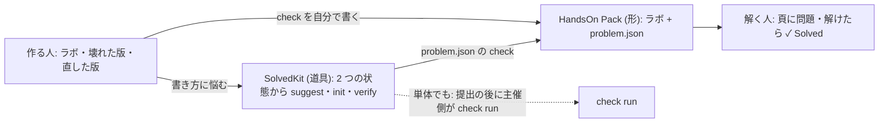

# SolvedKit の手引き: ラボを「解いたら ✓ が付く問題」にする

*[English](../solvedkit.md) | 日本語*

形と道具:

- **HandsOn Pack** は**形**で、プログラムではありません。containerlab のラボを問題として配る形で、トポロジーの隣に
  `problem.json` を置きます ([その形](problem-format.md))。network-xray のほかに入れる物はありません。
- **SolvedKit** は**道具**です。壊れた版と直した版の状態から、`check` (いつ解けたとするか) を作ります。

**HandsOn Pack で演習を配り、SolvedKit で判定を作ります。** 片方だけでも使えます: check を手で書く、または HandsOn Pack
なしで SolvedKit の `check run` だけを使う (containerlab と Cisco CML のラボ)。



**入口は 2 つ。**

- **問題を解きたい (解く人)。** containerlab と Docker の入った Linux が要ります。公式の例を立てて http://localhost:8080/ を
  開きます (図の上に問題・ラボを直すと ✓ Solved):

  ```
  git clone https://github.com/rclab-dev/network-xray.git
  cd network-xray
  ./xray.sh examples/q21-bgp-lp/q21.clab.yml
  ```

- **問題を作る (作る人)。** この先を読んでください。急ぐ人は [2. はじめての 5 分](#2-はじめての-5-分) だけ。

1. [これは何か、何でないか](#1-これは何か何でないか)
2. [はじめての 5 分](#2-はじめての-5-分)
3. [表の読み方](#3-表の読み方)
4. [なぜ backup の条件を入れるか・なぜ解き方を縛らないか](#4-なぜ-backup-の条件を入れるかなぜ解き方を縛らないか)
5. [自分のラボで使う](#5-自分のラボで使う)
6. [problem.json の check を直す](#6-problemjson-の-check-を直す)
7. [困った時](#7-困った時)
8. [作る人がよく聞くこと](#8-作る人がよく聞くこと)
9. [AI アシスタントから使う (MCP)](#9-ai-アシスタントから使う-mcp)
10. [工事のリハーサルに使う (問題作りでなく)](#10-工事のリハーサルに使う-問題作りでなく)

## 1. これは何か、何でないか

SolvedKit は、ネットワークの問題と解答はできたが「このラボは解けた」という判定の条件をどう書くかで悩む人のための道具です。
直す前と直した後のラボの**状態** (network-xray が動いているルータから読んだ物。トポロジーのファイルではありません) を渡すと、
その条件 (`check`。例「r1 の 8.8.8.0/24 への best path は AS 65002 経由」) を提案し、条件が壊れたラボと直したラボを
見分けられるかを言います。containerlab (と netlab) のラボと Cisco CML のラボで使えます。

判定を使う先の 1 つが、ラボのトポロジーの隣に置く `problem.json` です。network-xray は図の上に問題を出し、直ると
**✓ Solved** を出します ([problem-format.md](problem-format.md))。採点の台本や CI でも、同じ check を `check run` で使えます。

- 壊れた版と直した版、2 つの保存した状態から check を**提案**します。何を入れるかを決めるのは作る人です。
- 保存した状態の上で check を、頁と同じ決まりで**判定**し、check が壊れたラボと直したラボを見分けられるかを言います。
- **読むだけ**です。ルータにログインせず、ラボを変えず、動いているラボも要りません。要るのは Node と状態のファイルだけです。
- 解いた人の**やり方は採点しません**。打った命令ではなく、最後にネットワークがどうなっているかを見ます。
- 正しい答えを**全部は見つけません**。直した版の状態 1 つは、解き方の 1 つを示すだけです
  ([4 章](#4-なぜ-backup-の条件を入れるかなぜ解き方を縛らないか))。

problem.json の形の全体は [problem-format.md](problem-format.md) にあります。

**どのルータで。** 状態は network-xray が読む物から来ます: containerlab / netlab の FRR・Nokia SR Linux・Cisco IOL、
Cisco CML のラボの IOS のノード (`iol-xe`・`ioll2-xe`・`iosv`・`iosvl2`・`csr1000v`・`cat8000v`)。ほかのノードは図に出ますが
読みません。そのノードについての条件は判定できない (`check run` は `cannot judge`、例 `cannot read r1: not in the state`、
終わりのコード 2) ので、check は読めるルータに置いてください。

## 2. はじめての 5 分

**始める前に。** 要るのは Node 18 以上 (`node -v`) と network-xray の写しです。この手引きの命令は全部 network-xray の
フォルダで打ちます:

```
git clone https://github.com/rclab-dev/network-xray.git
cd network-xray
```

repo には q21 のラボ (BGP: r1 が r2 経由の経路を選ぶべき) の録画した状態が 2 つあります。
`demo/bgp-lp/frameA.json` が直す前、`demo/bgp-lp/frameB.json` が直した後です。repo のフォルダで打ってください。


**1 手目: check を提案させる。**

```
node scripts/xray-query.js check suggest demo/bgp-lp/frameA.json demo/bgp-lp/frameB.json --format table
```

```
Suggested check: ok (fails on broken, holds on solved)
  USE  KIND    TELLS APART  CONDITION
  *    path    yes          r1 bgp_routes some [["prefix","eq","8.8.8.0"],["prefixlen","eq",24],["~
  -    path    yes          r1 routing_table some [["prefix","eq","8.8.8.0/24"],["selected","eq",t~
  *    backup  no           r1 bgp_routes some [["prefix","eq","8.8.8.0"],["prefixlen","eq",24],["~

* = in the proposed check; TELLS APART yes = fails on broken, holds on solved (no = holds on both)
```

条件を 3 つ見つけ、そのうち 2 つ (`*`) を提案の check に入れました。r1 の 8.8.8.0/24 への best path が AS 65002 経由に
なったこと、古い AS 65003 経由の経路がまだあること、です。列の意味は [3 章](#3-表の読み方)。`~` で切れた行は、
`--format table` を外す (JSON) と全部出ます。

**2 手目: problem.json の下書きを書く。**

```
node scripts/xray-query.js check init demo/bgp-lp/frameA.json demo/bgp-lp/frameB.json --out mylab/problem.json --format table
```

同じ表の後に、こう出ます:

```
written: mylab/problem.json
still to fill in by hand: title_en / title_ja; problem_en / problem_ja; id (e.g. "yourname/yourrep~
```

下書きには check が入り、`title_*`・`problem_*`・`id` が空で入っています (自分で書く所)。フォルダが無ければ作ります。
既にある problem.json は上書きしません。

**3 手目: 1 つの状態を判定する。**

```
node scripts/xray-query.js check run mylab/problem.json demo/bgp-lp/frameB.json --format table
```

```
Solved: solved
  HOLDS  CONDITION
  yes    r1 bgp_routes some [["prefix","eq","8.8.8.0"],["prefixlen","eq",24],["best","eq",true],["~
  yes    r1 bgp_routes some [["prefix","eq","8.8.8.0"],["prefixlen","eq",24],["as_path","eq","6500~
```

`frameA.json` (壊れたラボ) だと 1 行目が `Solved: not solved`、最初の条件が `no` になります。終わりのコードは
解けた 0・解けていない 1・判定できない 2 です。

**4 手目: check が 2 つを見分けるか確かめる。**

```
node scripts/xray-query.js check verify mylab/problem.json demo/bgp-lp/frameA.json demo/bgp-lp/frameB.json --format table
```

```
Check: ok (broken: not solved, solved: solved)
  BROKEN  SOLVED  VERDICT  CONDITION
  no      yes     tells    r1 bgp_routes some [["prefix","eq","8.8.8.0"],["prefixlen","eq",24],["b~
  yes     yes     both     r1 bgp_routes some [["prefix","eq","8.8.8.0"],["prefixlen","eq",24],["a~

tells = fails on broken, holds on solved; both = holds on both; wrong = fails on solved
both is fine next to a tells (a backup line); wrong = the fixed lab would never be marked solved
```

`Check: ok` = 直した後にだけ印が付く、という意味です。流れはこれで全部です: suggest → init → run → verify。

## 3. 表の読み方

**判定の作り。** 良い check はたいてい 2 つの部分でできています。1 つは今そうなっているべき事 = 本体の経路 (q21 なら、r1 の
8.8.8.0/24 への best path が r2 経由)。もう 1 つはまだ残っているべき事 = 予備の経路 (r3 経由の経路がまだある)。両方が
成り立つ時だけ解けたことになります。下の表は、この部分を行として見せます。

**`check suggest` / `check init`**

| 列 | 値 | 意味 |
|---|---|---|
| USE | `*` | 提案の check に入っている |
| | `-` | これも使える候補・入れていない (要るなら手で足す) |
| KIND | `path` | 経路がある interface 経由で選ばれた、または BGP の best path が直した結果の物になった |
| | `evidence` | 直した版で OSPF の隣接が Full・BGP のセッションが Established・interface が up |
| | `backup` | 古い best path がまだある ([4 章](#4-なぜ-backup-の条件を入れるかなぜ解き方を縛らないか)) |
| | `gone` | 消えた経路。ほかに 2 つを見分ける物が無い時だけ使う |
| TELLS | `yes` | 壊れた版で成り立たず、直した版で成り立つ |
| | `no` | 両方で成り立つ (`backup` では普通) |
| CONDITION | | `[node, path, op, value]`: ルータ・その状態のどこ (`bgp_routes`・`routing_table`・`ospf_neighbors`・`bgp_neighbors`・`interfaces.eth1.up` など)・op (`some` = 合う行が 1 つ以上・`none` = 合う行が無い・`eq` など)・値 |

提案の check は、最初の `path`・同じルータの `evidence`・BGP の best path の `backup` で、最大 3 つです (`--max <n>` で
変えられます)。1 行目は、その check が壊れた版で成り立たず直した版で成り立てば `ok`、見分ける条件が無ければ `none` と
わけを出します。`not used: N change(s)` は、見えたが使えなかった変化の数です。`--format json` の `skipped` に
1 つずつのわけがあります。

**`check run`**: `Solved:` は `solved`・`not solved`・`cannot judge`。HOLDS は `yes`・`no`・`?` (そのルータが状態の中で
読めない)。

**`check verify`**: BROKEN / SOLVED は、各条件がそれぞれの状態で成り立つか。VERDICT:

| VERDICT | 意味 | すること |
|---|---|---|
| `tells` | 壊れた版で成り立たず、直した版で成り立つ | check が働くのはこれのおかげ |
| `both` | 両方で成り立つ | `tells` と並んでいれば良い (backup の条件は `both`) |
| `wrong` | 直した版で成り立たない | 直したラボに印が付かない: この条件を消すか直す |
| `unknown` | 条件の中のルータが読めない | 全部のルータが上がってから集め直す |

`Check: ok` には、`tells` が 1 つ以上あり、`wrong` が無いことが要ります。

## 4. なぜ backup の条件を入れるか・なぜ解き方を縛らないか

backup の行は壊れた版と直した版を見分けません (TELLS `no`)。それでもわざと check に入れています。無いと、q21 を
別のやり方で「直した」ことになってしまいます。r1 と r3 の間の線を切ると AS 65003 経由の経路が消え、問題が求める
変更をしないまま AS 65002 経由が best になります。backup の条件があれば古い経路が残っている必要があるので、
「古い経路もまだ使えるのに、r1 が新しい経路を選んでいる」時だけ解けたことになります。

一方で、check は解き方を 1 つに縛りません。どの命令でそうしたかではなく、ネットワークがどうなっているかを言うので、
q21 なら r2 からの経路の Local Preference を上げる、ほかの方法で r1 に r2 を選ばせる (r3 は予備に残す)、のどれでも
解けたことになります。

経路をどう学んだか (`protocol`。例 `ospf` か `bgp`) は、既定では提案の check に入れません。直したことでそれが
変わった時、`suggest` は別の候補として出します (JSON では `binds_method` と注)。同じ経路に別のやり方で届く直し方も
解けたことにするためです。問題がそのやり方を求める時 (「r1 がこの経路を OSPF で学ぶように」) だけ足してください
([6 章](#6-problemjson-の-check-を直す))。

## 5. 自分のラボで使う

どのラボでも流れは同じです: 壊れた版を保存 → 直した版を保存 → suggest → init → verify。

**状態を保存する。** network-xray の collector は、ラボの状態を毎回 `xray-states.js` に書きます。欲しい時にそれを写します:

| network-xray の動かし方 | 状態のある所 |
|---|---|
| `./xray.sh <lab>.clab.yml` (containerlab) | network-xray のフォルダの `xray-states.js`。別の端末で `./xray.sh snapshot broken` と打つと `broken.js` に保存 |
| image (`docker run … ghcr.io/rclab-dev/network-xray`) | コンテナの中: `curl -s http://localhost:8600/static/xray-states.js > broken.js` |
| netlab (network-xray の defaults ファイル) | これも image: `./xray.sh snapshot broken --url http://localhost:8600` (か上の `curl` の行)。状態に netlab の管理の網が入っている時は、`check suggest` に `--mgmt-subnet 192.168.121.0/24` を足す (その網の変化を候補に入れない) |
| Cisco CML (`node cml-xray.js …`) | `--out` のフォルダ (既定 `./cml-view`) の `xray-states.js` |
| MCP のサーバ (`--allow-collect`) | `collect` に `keep_previous: true` で、前の状態が `previous` に残る |

保存した `xray-states.js`・`state_<node>.json`・それらの入ったフォルダの、どれでも入力にできます。

**流れ。**

1. ラボを立て、問題として出す形に壊します。頁が壊れた状態を見せたら保存: `./xray.sh snapshot broken` (image か netlab なら `--url http://localhost:8600` を足す)。
2. 解く人がするだろうやり方で直します。頁が変化を見せるまで待ち (BGP や OSPF は落ち着くまで数十秒かかることがあります)、
   `./xray.sh snapshot solved` で保存します。
3. `node scripts/xray-query.js check suggest broken.js solved.js --format table`。問題と関係の無い所までラボが変わる時は、
   ルータと宛先から始めます: `--focus r1 --prefix 8.8.8.0/24`。
4. `node scripts/xray-query.js check init broken.js solved.js --out <ラボのフォルダ>/problem.json` の後、その中に
   題・問題の文・`id` を書きます。言葉は片方だけで良く、`title_en` / `title_ja` (と `problem_*`) の無い方はもう片方で出ます。
   `solved_text_en` / `solved_text_ja` (省ける) は解けた時に出る短い文で、たとえば直し方がなぜ効くかを書きます。
5. `node scripts/xray-query.js check verify <ラボのフォルダ>/problem.json broken.js solved.js --format table` が
   `Check: ok` になること。CI でまた流したいなら `broken.js` と `solved.js` をラボの隣に置いておきます。
6. network-xray でラボを開き、自分で 1 回解いて ✓ Solved が出るのを見ます。

**Cisco CML。** `cml-xray.js` は CML のサーバの中ではなく、手元の機械で動かします。CML で動いているラボを、CML の
REST API とラボの管理の網経由で読みます
(準備は [README](../../README.md#cisco-cml2-cml-free-でも)。要る[管理の網](../../README.md#cml-のラボに管理の網を足す)も):

```
export CML_HOST=<CML のアドレス> CML_USER=<CML のユーザ> CML_PASSWORD=<そのパスワード>
export NX_IOS_USER=admin NX_IOS_PASSWORD=<ルータのパスワード>
node cml-xray.js --save-cert cml.pem      # 1 回だけ
export CML_CA_FILE=cml.pem
node cml-xray.js --lab "<CML でのラボの題>"
```

動いている間、状態は `cml-view/xray-states.js` (`--out` のフォルダ) です。CML でラボを壊し、http://127.0.0.1:8710/ の
頁に出たら `cp cml-view/xray-states.js broken.js`。直して待ち、`cp cml-view/xray-states.js solved.js`。あとは上と同じです。

**解く人に見える物。** problem.json をラボのトポロジーのファイル (`<lab>.clab.yml`) の隣に置きます。解く人は network-xray
でラボを立て (`./xray.sh <lab>.clab.yml` か image)、図の上に題と問題を見ます。check が約 10 秒成り立ち続けると
✓ Solved が出ます。

### 頁なしで採点する (CLI か CI だけ)

ラボを判定するのに network-xray の頁は要りません。collector と `check run` で足ります。

**CI で。** collector は `--watch` を付けなければ、動いているラボを 1 回読みます。出力のフォルダは network-xray の
フォルダ (そこに `xray-states.js` を書く) で、3 つ目の引数はプロトコル (`bgp`、既定は `ospf`) です。containerlab の
ある機械と公式の例 q21 で、network-xray のフォルダで試した流れ:

- `clab-xray-collect.js` は network-xray のフォルダの一番上にあります。
- 2 つ目の引数 (`.`) は `xray-states.js` を書くフォルダで、network-xray のフォルダそのものです (そこにあるほかの
  ファイルが要ります)。
- `check run` には、problem.json のあるラボのフォルダか、problem.json のファイルそのものを渡します。

```
containerlab deploy -t examples/q21-bgp-lp-solved/q21.clab.yml
sleep 60                                               # BGP が落ち着くのを待つ
node clab-xray-collect.js examples/q21-bgp-lp-solved/q21.clab.yml . bgp
node scripts/xray-query.js check run examples/q21-bgp-lp-solved xray-states.js --format table
containerlab destroy -t examples/q21-bgp-lp-solved/q21.clab.yml --cleanup
```

```
Solved: solved
  HOLDS  CONDITION
  yes    r1 bgp_routes some [["prefix","eq","8.8.8.0"],["best","eq",true],["as_path","eq","65002"]]
  yes    r1 bgp_routes some [["prefix","eq","8.8.8.0"],["as_path","eq","65003"]]
```

`check run` は 0 で終わるので、job は通ります。解いていない `examples/q21-bgp-lp` では `not solved` と出て 1 で終わります。

**解く人に check を見せたくない時** (競技・採点する演習): `check` を抜いた problem.json を配り (問題は出て、✓ Solved は
出ません)、全部入りの物は手元に置きます。解く人はそれぞれ自分のラボの状態を出します (network-xray のフォルダで
`cp xray-states.js <名前>.js`)。それをまとめて判定します:

```
for f in submissions/*.js; do
  node scripts/xray-query.js check run my-problem.json "$f" > /dev/null; rc=$?
  echo "$f $rc"          # 0 解けた・1 解けていない・2 判定できない
done
```

録画した q21 の状態 (壊れた版・直した版・直した版から r1 を抜いた物) で試した結果:

```
submissions/alice.js 1
submissions/bob.js 0
submissions/carol.js 2
```

## 6. problem.json の check を直す

条件は `[node, path, op, value]` です。op が `some` の時、値は `[field, op, value]` の並びで、「そのルータのその path に、
`[field, op, value]` が全部成り立つ行が 1 つ以上ある」という意味です (`none` は、そういう行が無い)。`all` の条件が
全部成り立てば check が成り立ちます。2 手目の下書き:

```json
"check": {
  "all": [
    ["r1", "bgp_routes", "some", [["prefix", "eq", "8.8.8.0"], ["prefixlen", "eq", 24], ["best", "eq", true], ["as_path", "eq", "65002"]]],
    ["r1", "bgp_routes", "some", [["prefix", "eq", "8.8.8.0"], ["prefixlen", "eq", 24], ["as_path", "eq", "65003"]]]
  ]
}
```

path・field・12 の op は [problem-format.md](problem-format.md#check) にあります。よくある直し 3 つ:

1. **正しい答えが複数ある。** r1 が AS 65002 経由でも AS 65004 経由でも良いとします。直す前:

   ```json
   ["r1", "bgp_routes", "some", [["prefix", "eq", "8.8.8.0"], ["prefixlen", "eq", 24], ["best", "eq", true], ["as_path", "eq", "65002"]]]
   ```

   直した後 (`in` は並びを取ります):

   ```json
   ["r1", "bgp_routes", "some", [["prefix", "eq", "8.8.8.0"], ["prefixlen", "eq", 24], ["best", "eq", true], ["as_path", "in", ["65002", "65004"]]]]
   ```

   この直しの後も、録画した q21 の状態で `check verify` は `Check: ok` です。
2. **やり方を求める。** 問題が「OSPF で」と言うなら、`suggest` が出した `protocol` の候補を足します: 経路の条件に
   `["protocol", "eq", "ospf"]`。
3. **厳しすぎる条件を外す。** `check verify` で `wrong` になる条件や、ひとりでに変わる値 (タイマー・uptime) は、
   その条件かその field を消します。

直すたびに `check verify` をもう一度流してください。

## 7. 困った時

誤りは `error: …` として stderr に出て終わりのコードが 2 (`--format table` の時)、または `{"error": …}` で出ます。

| 出る文 | わけ | すること |
|---|---|---|
| `Suggested check: none` / `no difference between the two states (the fix changed nothing the collector reads)` | 2 つのファイルが同じ状態、または直した所が collector の読まない物 | 頁が変化を見せてから直した版を保存し直す・別々のファイルを渡したか見る |
| `no condition the check can use tells the broken state from the solved one - see skipped` | 変化が check の使わない種類 (設定の値・ping) | `--format json` で `skipped` を読む・その変化がもたらす経路や隣接を条件にする |
| `the proposed check did not verify: …` | 提案した条件をまとめると、壊れた版で成り立たず直した版で成り立つ、にならなかった | コロンの後のわけを読む・`--focus` / `--prefix` を試す |
| `Solved: cannot judge` / `cannot read r2: not in the state` | check が名指すルータが状態の中に無い | ルータの名前が違う (`node scripts/xray-query.js state <file>` で見る)、または保存した時に上がっていなかった |
| `cannot read r2: not readable (…)` | collector がそのルータを読めなかった | 上がるのを待って状態を保存し直す |
| `no check (problem.json has no check.all)` | problem.json にまだ check が無い | `check init` を流すか `check.all` を足す |
| `... is a state file (xray-states.js), not a problem.json` | `check run` の 2 つの引数が逆 | `check run <problem.json> <state>` |
| `unsupported format "…" (network-xray-lab/0 only)` | problem.json の `format` が別の値 | `"format": "network-xray-lab/0"` にする |
| `unknown node: r9 (not in the solved state)` | `--focus` が直した版に無いルータを名指している | 状態の中の名前を使う |
| `not written: … already exists (SolvedKit does not overwrite a problem.json)` | `--out` が既にあるファイルを指している | 別の名前にするか、古い方をよける |
| `no node state found in input` / `not valid JSON: …` | ファイルが network-xray の状態ではない | 保存した `xray-states.js` (か `state_<node>.json`) を渡す |
| `not found: …` / `no problem.json in …` | path が違う | path を見る・フォルダなら中に `problem.json` が要る |
| `--max must be a number from 1 to 99` | `--max` が数でない | 数を渡す |

**提案がおかしく見える。** いちばん多いのは、ラボが落ち着く途中で保存した状態です。頁の変化が止まってから保存し直して
ください。次は、問題と関係の無い所までラボが変わっている場合で、`--focus` と `--prefix` を使います。

## 8. 作る人がよく聞くこと

- **どのラボで使える?** network-xray が読める物なら: containerlab / netlab の FRR・Nokia SR Linux・Cisco IOL、
  `cml-xray.js` 経由の Cisco CML (IOL と IOS-XE)。
- **BGP の無い、OSPF だけのラボは?** 使えます。条件は `routing_table` の経路と `ospf_neighbors` の隣接になります。
- **正しい答えが複数ある問題は?** check はネットワークがどうなっているべきかに絞り、答えごとに違う所は入れません
  ([6 章](#6-problemjson-の-check-を直す) の 1)。できれば答えごとに直した版を保存して確かめてください。
- **頁は ✓ Solved を出す前に待つ?** はい。check が成り立ち続けるのを約 10 秒待ちます。`check run` は 1 回の読みで判定します。
- **CI で使える?** 使えます。`check run` と `check verify` は 0 / 1 / 2 で終わり、要るのは Node とファイルだけです。
- **ラボを変えたり、ルータにログインしたりする?** しません。渡されたファイルを読むだけです。
- **`suggest` が何も見つけないのは?** 直す前と後で、network-xray が読む状態に差が出ない時です。試した中では、IPv6・BFD・
  eBGP multihop・route reflector・BGP wedgies・remove-private-as・route server の一部の問題がそうでした。`suggest` は `none` と
  言うので、check は手で書きます ([6 章](#6-problemjson-の-check-を直す))。
- **ping の結果や設定の値は?** check が読むのは状態で、設定ではありません。値そのものではなく、その値がもたらす物
  (隣接・経路) を条件にします。ping の結果は状態に入っていません。
- **解く人に check は見える?** 配る problem.json に入っていれば見えます (ファイルを開けば読めます)。困る時は `check` を抜いた
  problem.json を配り、提出の後に自分で `check run` を流します ([5 章](#5-自分のラボで使う) の「解く人に check を見せたくない時」)。
- **形の全体はどこ?** [problem-format.md](problem-format.md)。

## 9. AI アシスタントから使う (MCP)

MCP のサーバ ([mcp.md](mcp.md)) にも同じ 4 つが、読むだけの道具としてあります: `check_run` (`problem`・`path`)・
`check_verify` (`problem`・`broken`・`solved`)・`check_suggest` と `check_init` (`broken`・`solved`、省ける `focus`・
`prefix`・`mgmt_subnet`)。`check_init` は下書きを JSON で返し、ファイルは書きません。ファイルはサーバが読むフォルダ
(その `--path`) の下に置きます。たとえば「broken.js と solved.js から check を提案して、確かめて」と聞きます。

**AI アシスタントとの例。** 利用者は、サーバが読むラボのフォルダに `broken.js` と `solved.js` を保存してあります。

1. 利用者:「broken.js と solved.js から、このラボの解けた判定を作って」。
2. アシスタントは `check_suggest` (`broken`・`solved`) を呼び、候補を見せます: それぞれが何を言うか、どれが 2 つの状態を見分けるか。
3. `check_init` を呼び、problem.json の下書きを見せます (題と問題の文は利用者が書く所として空)。
4. その下書きに `check_verify` を呼び、`ok` (か、どの条件が `wrong` か) を見せます。
5. 利用者が題と問題の文を書いて保存します。check を通すためにアシスタントがラボを変えることはしません。

## 10. 工事のリハーサルに使う (問題作りでなく)

同じ道具は、ネットワークの工事 (変更作業) にも使えます。本番に似せたラボで手順を流し、手順がすべき事をして、ほかを
壊していないかを状態で確かめます。check はその工事の合格の条件になり、手順を直すたびに流し直せます (CI でも)。

公式の `examples/q6-ospf-solved` (r1 - r2 - r3 の三角・OSPF) で試しました: r1 - r3 の回線の保守の前に、r1 と r3 の間の
通信 (r3 の `3.3.3.3`・r1 の先の `10.10.0.0/24`) を r2 経由に移し、r1 - r3 は予備として残す工事です。ラボを動かした
状態で、network-xray のフォルダから:

```
node clab-xray-collect.js examples/q6-ospf-solved/q6.clab.yml . ospf && cp xray-states.js before.js
sleep 40; node clab-xray-collect.js examples/q6-ospf-solved/q6.clab.yml . ospf && cp xray-states.js before2.js
node scripts/xray-query.js diff before.js before2.js --format table      # (none) = ラボが落ち着いている
```

**1. 「前」はラボが落ち着いてから取る。** 2 回取り、`diff` が `(none)` であること。OSPF が収束する途中で取った状態は
次の回と違い、5 の戻しの確かめで、手順がしていない変化が出てしまいます。

**2. 手順を流して「後」を取り、`--for change` で何が動いたかを見る。** 手順の 1 回目は r1 だけ OSPF の cost を上げました
(`interface eth2` / `ip ospf cost 100`):

```
node scripts/xray-query.js check suggest before.js half.js --for change --format table
  USE  KIND  TELLS APART  CONDITION
  *    path  yes          r1 routing_table some [["prefix","eq","3.3.3.3/32"],["selected","eq",tru~
  *    path  yes          r2 routing_table some [["prefix","eq","10.11.0.0/24"],["selected","eq",t~
  *    keep  no           r1 ospf_neighbors some [["router_id","eq","10.12.0.10"],["full","eq",tru~
  ...
```

r3 の行がありません: r3 から r1 への帰りの道は動いていない (直通のまま)。手順は r3 の側 (r3 の `interface eth1`) の
cost も上げる要があります。両側を変えると:

```
node scripts/xray-query.js check init before.js after.js --for change --out change/problem.json --format table
  USE  KIND  TELLS APART  CONDITION
  *    path  yes          r1 routing_table some [["prefix","eq","3.3.3.3/32"],["selected","eq",tru~
  *    path  yes          r3 routing_table some [["prefix","eq","10.10.0.0/24"],["selected","eq",t~
  *    keep  no           r1 ospf_neighbors some [["router_id","eq","10.12.0.10"],["full","eq",tru~
  *    keep  no           r1 ospf_neighbors some [["router_id","eq","3.3.3.3"],["full","eq",true]]
  ...                     (r2 と r3 も同じ・隣接はみな Full のまま)
```

`--for change` を付けない `check suggest` は問題作り向けの check を作ります: 直しを見分ける最少の条件 (ここでは r1 の
経路だけ) で、別の正しい直し方も通る様に。工事はその逆で、動かす物は**行きも帰りも**全部、触ってはいけない物
(`keep` = 前と後の両方で Full の OSPF の隣接・Established の BGP のセッション) も全部要ります。`--max <n>` で数を
抑えられるのは同じです。

**3. 予備を確かめる。** 新しい道を落とした 3 つ目の状態を取り (r1 で `ip link set eth1 down`)、切り替わりの check も
同じやり方で「後」からその状態へ作ります:

```
node scripts/xray-query.js check init after.js backup.js --for change --out backup/problem.json
node scripts/xray-query.js check run backup backup.js                   # solved = r1 は直通で 3.3.3.3 に届く
```

落とした線の上の経路はその状態では消えるので `gone` に出て、check には入りません。

**4. 本番の工事の後に同じ check を流す** (network-xray がそのルータを読める時)。読めなければ、リハーサルで確かめた事の
記録として残します。

**5. 戻して「前」と比べる。** `check run change/problem.json rolled.js` は `not solved` (工事が消えた)、
`diff before.js rolled.js` は `(none)`: 戻しでラボが元どおり。

**分からない事。** 当たるのはラボが本番に似ている分だけです (同じ形・同じプロトコル・効く所は同じ値)。読めるのは
containerlab / netlab のラボの FRR・Nokia SR Linux・Cisco IOL と、Cisco CML のラボの IOS のルータで ([使い所](../../README.md#when-to-use))、本番のルータにはログインしません。
見るのは経路の状態 (経路・隣接・セッション) で、パケットやアプリケーションは見ません。
