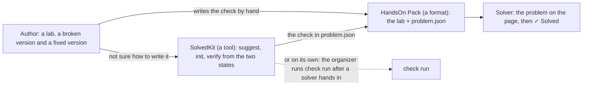

# SolvedKit guide: turn your lab into a puzzle with a solved check

*English | [日本語](ja/solvedkit.md)*

A format and a tool:

- **HandsOn Pack** is a **format**, not a program: a containerlab lab handed out as a problem, with a `problem.json` next
  to its topology ([the format](problem-format.md)). Nothing to install beyond network-xray.
- **SolvedKit** is a **tool**: it makes the `check` (when the lab counts as solved) from a broken and a fixed state.

**Hand out exercises as a HandsOn Pack, and make their check with SolvedKit.** Either works without the other: write the
check by hand, or use SolvedKit's `check run` on its own (for containerlab and Cisco CML labs) with no HandsOn Pack at all.



**Two ways in.**

- **You want to solve a problem (Solver).** You need Linux with containerlab and Docker. Start the official example
  and open http://localhost:8080/ (the problem is above the graph; ✓ Solved appears when you fix the lab):

  ```
  git clone https://github.com/rclab-dev/network-xray.git
  cd network-xray
  ./xray.sh examples/q21-bgp-lp/q21.clab.yml
  ```

- **You make problems (Author).** Read on. In a hurry? Read [2. Your first five minutes](#2-your-first-five-minutes) only.

1. [What it is, and what it is not](#1-what-it-is-and-what-it-is-not)
2. [Your first five minutes](#2-your-first-five-minutes)
3. [Reading the tables](#3-reading-the-tables)
4. [Why the check keeps a backup line, and why it allows more than one way to solve](#4-why-the-check-keeps-a-backup-line-and-why-it-allows-more-than-one-way-to-solve)
5. [Using it on your own lab](#5-using-it-on-your-own-lab)
6. [Editing the check in problem.json](#6-editing-the-check-in-problemjson)
7. [When something goes wrong](#7-when-something-goes-wrong)
8. [Questions authors ask](#8-questions-authors-ask)
9. [From an AI assistant (MCP)](#9-from-an-ai-assistant-mcp)
10. [Rehearsing a change (not a puzzle)](#10-rehearsing-a-change-not-a-puzzle)

## 1. What it is, and what it is not

SolvedKit is for you if you have a network problem and its answer, and you are stuck on how to write the condition
that says "this lab is solved". You give it the lab's **state** before the fix and after it (what network-xray reads
from the running routers, not the topology file), and it proposes that condition (a `check`: "r1's best path to
8.8.8.0/24 goes through AS 65002"), and tells you whether a condition tells the broken lab from the fixed one. It works
with containerlab labs (and netlab) and Cisco CML labs.

One place to use the check: a `problem.json` next to the lab's topology. network-xray then shows the problem above the
graph and a **✓ Solved** mark once the lab is fixed ([problem-format.md](problem-format.md)). A grading script or a CI
job can use the same check with `check run`.

- It **proposes** a check from two saved states of the lab: one broken, one fixed. You decide what goes in.
- It **judges** a check on a saved state, with the same rules as the page, and tells you whether the check tells the
  broken lab from the fixed one.
- It **reads only**. It does not log in to routers, does not change the lab, and needs no running lab: only Node and
  the state files.
- It is **not** a grader of how someone solved the problem. It looks at what the network does in the end, not at the
  commands that were typed.
- It does **not** find every correct answer. One fixed state shows one way to solve the problem; see
  [section 4](#4-why-the-check-keeps-a-backup-line-and-why-it-allows-more-than-one-way-to-solve).

The full problem.json format is in [problem-format.md](problem-format.md).

**Which routers.** The states come from what network-xray reads: FRR, Nokia SR Linux and Cisco IOL in containerlab or
netlab, and the IOS nodes of a Cisco CML lab (`iol-xe`, `ioll2-xe`, `iosv`, `iosvl2`, `csr1000v`, `cat8000v`). Other nodes
are drawn but not read: a condition on such a node cannot be judged (`check run` says `cannot judge`, for example
`cannot read r1: not in the state`, and exits 2), so put the check on routers that are read.

## 2. Your first five minutes

**Before you start.** You need Node 18 or later (`node -v`) and a copy of network-xray. Run every command in this guide
from the network-xray folder:

```
git clone https://github.com/rclab-dev/network-xray.git
cd network-xray
```

The repository has two recorded states of the q21 lab (BGP: r1 should prefer the path through r2):
`demo/bgp-lp/frameA.json` is before the fix and `demo/bgp-lp/frameB.json` after it. Run these from the repository
folder.

**Step 1: let it suggest the check.**

```
node scripts/xray-query.js check suggest demo/bgp-lp/frameA.json demo/bgp-lp/frameB.json --format table
```

```
Suggested check: ok (fails on broken, holds on solved)
  USE  KIND    TELLS APART  CONDITION
  *    path    yes          r1 bgp_routes some [["prefix","eq","8.8.8.0"],["prefixlen","eq",24],["~
  -    path    yes          r1 routing_table some [["prefix","eq","8.8.8.0/24"],["selected","eq",t~
  *    backup  no           r1 bgp_routes some [["prefix","eq","8.8.8.0"],["prefixlen","eq",24],["~

* = in the proposed check; TELLS APART yes = fails on broken, holds on solved (no = holds on both)
```

It found three conditions and put two of them (`*`) in the proposed check: r1's best path to 8.8.8.0/24 is now the
one through AS 65002, and the old path through AS 65003 is still there. [Section 3](#3-reading-the-tables) explains
each column. A line cut with `~` is shown in full without `--format table` (JSON).

**Step 2: write a problem.json draft.**

```
node scripts/xray-query.js check init demo/bgp-lp/frameA.json demo/bgp-lp/frameB.json --out mylab/problem.json --format table
```

It prints the same table and then:

```
written: mylab/problem.json
still to fill in by hand: title_en / title_ja; problem_en / problem_ja; id (e.g. "yourname/yourrep~
```

The draft has the check filled in and empty `title_*`, `problem_*` and `id` for you to write. The folder is made when
it is not there; an existing problem.json is never overwritten.

**Step 3: judge one state.**

```
node scripts/xray-query.js check run mylab/problem.json demo/bgp-lp/frameB.json --format table
```

```
Solved: solved
  HOLDS  CONDITION
  yes    r1 bgp_routes some [["prefix","eq","8.8.8.0"],["prefixlen","eq",24],["best","eq",true],["~
  yes    r1 bgp_routes some [["prefix","eq","8.8.8.0"],["prefixlen","eq",24],["as_path","eq","6500~
```

With `frameA.json` (the broken lab) the first line says `Solved: not solved` and the first condition `no`. The exit
code is 0 for solved, 1 for not solved, 2 for cannot judge.

**Step 4: check that the check tells the two apart.**

```
node scripts/xray-query.js check verify mylab/problem.json demo/bgp-lp/frameA.json demo/bgp-lp/frameB.json --format table
```

```
Check: ok (broken: not solved, solved: solved)
  BROKEN  SOLVED  VERDICT  CONDITION
  no      yes     tells    r1 bgp_routes some [["prefix","eq","8.8.8.0"],["prefixlen","eq",24],["b~
  yes     yes     both     r1 bgp_routes some [["prefix","eq","8.8.8.0"],["prefixlen","eq",24],["a~

tells = fails on broken, holds on solved; both = holds on both; wrong = fails on solved
both is fine next to a tells (a backup line); wrong = the fixed lab would never be marked solved
```

`Check: ok` means the lab gets the mark only after the fix. That is the whole loop: suggest, init, run, verify.

## 3. Reading the tables

**How a check is built.** A good check usually has two parts. One says what must now be true: the main path (in q21,
r1's best path to 8.8.8.0/24 goes through r2). The other says what must still be true: the backup (the path through r3
is still there). The lab is solved only when both hold. The tables below show these parts as rows.

**`check suggest` / `check init`**

| Column | Values | Meaning |
|---|---|---|
| USE | `*` | in the proposed check |
| | `-` | a candidate that also works, left out (add it by hand if you want it) |
| KIND | `path` | a route is now selected through an interface, or a BGP best path is the one the fix made |
| | `evidence` | an OSPF adjacency is Full, a BGP session is Established, or an interface is up, in the fixed state |
| | `backup` | the old best path is still there (see [section 4](#4-why-the-check-keeps-a-backup-line-and-why-it-allows-more-than-one-way-to-solve)) |
| | `gone` | a route that disappeared; used only when nothing else tells the two states apart |
| TELLS | `yes` | fails on the broken state and holds on the fixed one |
| | `no` | holds on both (normal for `backup`) |
| CONDITION | | `[node, path, op, value]`: the router, the part of its state (`bgp_routes`, `routing_table`, `ospf_neighbors`, `bgp_neighbors`, `interfaces.eth1.up`, …), the op (`some` = at least one row matches, `none` = no row matches, `eq`, …) and the value |

The proposed check is the first `path`, the `evidence` on the same router, and the `backup` of a BGP best path, at most
three conditions (`--max <n>` to change it). The first line says `ok` when that check fails on broken and holds on
solved, or `none` with the reason when no condition tells the two apart. `not used: N change(s)` counts changes it saw
but could not use; `--format json` lists them under `skipped` with the reason for each.

**`check run`**: `Solved:` is `solved`, `not solved` or `cannot judge`; HOLDS is `yes`, `no` or `?` (that router cannot
be read in the state).

**`check verify`**: BROKEN / SOLVED say whether each condition holds in each state. VERDICT:

| VERDICT | Meaning | What to do |
|---|---|---|
| `tells` | fails on broken, holds on solved | this is what makes the check work |
| `both` | holds on both | fine next to a `tells` (a backup line is `both`) |
| `wrong` | fails on solved | the fixed lab would never get the mark: remove or correct this condition |
| `unknown` | a router in it cannot be read | collect again when every router is up |

`Check: ok` needs at least one `tells` and no `wrong`.

## 4. Why the check keeps a backup line, and why it allows more than one way to solve

The backup row does not tell broken from fixed (TELLS `no`), and it is in the check on purpose. Without it, another
way to "fix" q21 would also get the mark: cut r1's link to r3, and the path through AS 65003 disappears, so the path
through AS 65002 becomes best without the change the problem asks for. With the backup line, the old path must still
be there: the lab counts as solved only when r1 prefers the new path while the old one is still available.

At the same time, the check does not tie the solver to one way of solving. It says what the network does, not which
command made it so: in q21, raising Local Preference on r2's routes and other ways that make r1 prefer r2 while r3 stays
a backup all count.

How a route is learned (`protocol`, for example `ospf` or `bgp`) is kept out of the proposed check by default. When the
fix changed it, `suggest` lists it as a separate candidate (`binds_method` in the JSON, with a note) so that a fix
reaching the same route another way still counts. Add it to the check only if the problem asks for that method
("make r1 learn this route by OSPF"); see [section 6](#6-editing-the-check-in-problemjson).

## 5. Using it on your own lab

The steps are the same for every lab: save a broken state, save a fixed state, then suggest, init, verify.

**Save a state.** network-xray's collector writes the lab's state to `xray-states.js` every round. Copy it at the
moment you want:

| How you run network-xray | Where the state is |
|---|---|
| `./xray.sh <lab>.clab.yml` (containerlab) | `xray-states.js` in the network-xray folder: in another terminal, `./xray.sh snapshot broken` saves it as `broken.js` |
| the image (`docker run … ghcr.io/rclab-dev/network-xray`) | inside the container: `curl -s http://localhost:8600/static/xray-states.js > broken.js` |
| netlab with network-xray's defaults file | the image again: `./xray.sh snapshot broken --url http://localhost:8600` (or the `curl` line above). If the state includes netlab's management network, add `--mgmt-subnet 192.168.121.0/24` to `check suggest` so changes on it are left out |
| Cisco CML (`node cml-xray.js …`) | `xray-states.js` in the `--out` folder (default `./cml-view`) |
| the MCP server with `--allow-collect` | `collect` with `keep_previous: true` keeps the state before as `previous` |

A saved `xray-states.js`, a `state_<node>.json`, or a folder of them all work as input.

**The flow.**

1. Start the lab and break it the way the problem will be given. Wait until the page shows the broken state, then save
   it: `./xray.sh snapshot broken` (with the image or netlab: add `--url http://localhost:8600`).
2. Fix it the way you expect a solver to. Wait until the page shows the change (BGP and OSPF can take tens of seconds
   to settle), then `./xray.sh snapshot solved`.
3. `node scripts/xray-query.js check suggest broken.js solved.js --format table`. If the lab changes more than the
   problem is about, start from the router and destination: `--focus r1 --prefix 8.8.8.0/24`.
4. `node scripts/xray-query.js check init broken.js solved.js --out <your lab folder>/problem.json`, then write
   the title, the problem text and `id` in it. One language is enough: a missing `title_en` / `title_ja` (or `problem_*`)
   falls back to the other one. `solved_text_en` / `solved_text_ja` (optional) is a short note shown once the lab is
   solved, for example why the fix works.
5. `node scripts/xray-query.js check verify <your lab folder>/problem.json broken.js solved.js --format table` must say
   `Check: ok`. Keep `broken.js` and `solved.js` next to the lab if you want to run this again in CI.
6. Open the lab with network-xray, solve it once yourself, and see the ✓ Solved mark.

**Cisco CML.** `cml-xray.js` runs on your own machine, not on the CML server: it reads a lab running in CML over CML's
REST API and the lab's management network
(the setup is in the [README](../README.md#cisco-cml2-cml-free-works), including the
[management network](../README.md#add-a-management-network-to-a-cml-lab) it needs):

```
export CML_HOST=<your CML address> CML_USER=<your CML user> CML_PASSWORD=<its password>
export NX_IOS_USER=admin NX_IOS_PASSWORD=<the routers' password>
node cml-xray.js --save-cert cml.pem      # once
export CML_CA_FILE=cml.pem
node cml-xray.js --lab "<the lab's title in CML>"
```

While it runs, the state is `cml-view/xray-states.js` (the `--out` folder). Break the lab in CML, wait for the page at
http://127.0.0.1:8710/ to show it, `cp cml-view/xray-states.js broken.js`; fix it, wait, `cp cml-view/xray-states.js solved.js`.
The rest is the same as above.

**What the solver sees.** Put the problem.json next to the lab's topology file (`<lab>.clab.yml`). The solver starts the
lab with network-xray (`./xray.sh <lab>.clab.yml`, or the image) and sees the title and the problem above the graph; once
the check has held for about 10 seconds, the ✓ Solved mark appears.

### Grading without the page (CLI or CI only)

network-xray's page is not needed to judge a lab: the collector and `check run` are enough.

**In CI.** The collector reads a running lab once when you leave out `--watch`. Its output folder is the network-xray
folder (it writes `xray-states.js` there), and the third argument is the protocol (`bgp`, or `ospf`, the default). Tried
on a host with containerlab and the official q21 example, from the network-xray folder:

- `clab-xray-collect.js` is at the top of the network-xray folder.
- Its second argument (`.`) is the folder it writes `xray-states.js` to: the network-xray folder itself (it needs the
  other files there).
- `check run` takes the lab folder that has the problem.json, or the problem.json file itself.

```
containerlab deploy -t examples/q21-bgp-lp-solved/q21.clab.yml
sleep 60                                               # let BGP settle
node clab-xray-collect.js examples/q21-bgp-lp-solved/q21.clab.yml . bgp
node scripts/xray-query.js check run examples/q21-bgp-lp-solved xray-states.js --format table
containerlab destroy -t examples/q21-bgp-lp-solved/q21.clab.yml --cleanup
```

```
Solved: solved
  HOLDS  CONDITION
  yes    r1 bgp_routes some [["prefix","eq","8.8.8.0"],["best","eq",true],["as_path","eq","65002"]]
  yes    r1 bgp_routes some [["prefix","eq","8.8.8.0"],["as_path","eq","65003"]]
```

`check run` exits 0, so the job passes; on the unsolved `examples/q21-bgp-lp` it says `not solved` and exits 1.

**When solvers must not see the check** (a contest, a graded exercise): hand out a problem.json without `check` (the
problem is still shown, with no ✓ Solved mark) and keep the full one yourself. Each solver hands in the state of their
lab (`cp xray-states.js <name>.js` in their network-xray folder). Then judge them all at once:

```
for f in submissions/*.js; do
  node scripts/xray-query.js check run my-problem.json "$f" > /dev/null; rc=$?
  echo "$f $rc"          # 0 solved, 1 not solved, 2 cannot judge
done
```

Tried on the recorded q21 states (the broken one, the fixed one, and the fixed one with r1 missing):

```
submissions/alice.js 1
submissions/bob.js 0
submissions/carol.js 2
```

## 6. Editing the check in problem.json

A condition is `[node, path, op, value]`. With the op `some`, the value is a list of `[field, op, value]`: "the node has at
least one row at that path where every `[field, op, value]` is true" (`none`: no such row). The check holds when every
condition in `all` holds. The draft from step 2:

```json
"check": {
  "all": [
    ["r1", "bgp_routes", "some", [["prefix", "eq", "8.8.8.0"], ["prefixlen", "eq", 24], ["best", "eq", true], ["as_path", "eq", "65002"]]],
    ["r1", "bgp_routes", "some", [["prefix", "eq", "8.8.8.0"], ["prefixlen", "eq", 24], ["as_path", "eq", "65003"]]]
  ]
}
```

The paths, fields and the 12 ops are listed in [problem-format.md](problem-format.md#check). Three common edits:

1. **Accept more than one right answer.** Say r1 may prefer the path through AS 65002 or through AS 65004. Before:

   ```json
   ["r1", "bgp_routes", "some", [["prefix", "eq", "8.8.8.0"], ["prefixlen", "eq", 24], ["best", "eq", true], ["as_path", "eq", "65002"]]]
   ```

   After (`in` takes a list):

   ```json
   ["r1", "bgp_routes", "some", [["prefix", "eq", "8.8.8.0"], ["prefixlen", "eq", 24], ["best", "eq", true], ["as_path", "in", ["65002", "65004"]]]]
   ```

   `check verify` on the recorded q21 states still says `Check: ok` with this change.
2. **Require the method.** If the problem says "by OSPF", add the `protocol` candidate that `suggest` listed:
   `["protocol", "eq", "ospf"]` in the route's condition.
3. **Remove a condition that is too strict.** If `check verify` shows a condition as `wrong`, or a value that changes
   by itself (a timer, an uptime), delete that condition or that field.

Run `check verify` again after every edit.

## 7. When something goes wrong

Errors print as `error: …` on stderr with exit code 2 (with `--format table`), or as `{"error": …}`.

| Message | Cause | What to do |
|---|---|---|
| `Suggested check: none` / `no difference between the two states (the fix changed nothing the collector reads)` | the two files are the same state, or the fix changed something the collector does not read | save the fixed state again after the page shows the change; check that you passed two different files |
| `no condition the check can use tells the broken state from the solved one - see skipped` | the changes are of a kind a check does not use (a configured value, a ping) | run with `--format json` and read `skipped`; check the routes or adjacencies the change brings instead |
| `the proposed check did not verify: …` | the suggested conditions did not fail on broken and hold on solved together | read the reason after the colon; try `--focus` / `--prefix` |
| `Solved: cannot judge` / `cannot read r2: not in the state` | a router named in the check is missing from the state | the router name differs (check `node scripts/xray-query.js state <file>`), or it was not up when the state was saved |
| `cannot read r2: not readable (…)` | the collector could not read that router | wait until it is up and save the state again |
| `no check (problem.json has no check.all)` | the problem.json has no check yet | run `check init`, or add `check.all` |
| `... is a state file (xray-states.js), not a problem.json` | the two arguments of `check run` are swapped | `check run <problem.json> <state>` |
| `unsupported format "…" (network-xray-lab/0 only)` | `format` in problem.json is another value | set `"format": "network-xray-lab/0"` |
| `unknown node: r9 (not in the solved state)` | `--focus` names a router that is not in the fixed state | use a name from the state |
| `not written: … already exists (SolvedKit does not overwrite a problem.json)` | `--out` points at an existing file | pick another file name, or move the old one away |
| `no node state found in input` / `not valid JSON: …` | the file is not a network-xray state | pass the saved `xray-states.js` (or `state_<node>.json`) |
| `not found: …` / `no problem.json in …` | the path is wrong | check the path; a folder needs a `problem.json` inside |
| `--max must be a number from 1 to 99` | bad `--max` | give a number |

**The suggestion looks wrong.** The most common cause is a state saved while the lab was still converging: save it again
after the page has stopped changing. The second is a lab that changes more than the problem is about: use `--focus` and
`--prefix`.

## 8. Questions authors ask

- **Which labs does it work with?** Anything network-xray reads: FRR, Nokia SR Linux and Cisco IOL in containerlab or
  netlab, and Cisco CML (IOL and IOS-XE) through `cml-xray.js`.
- **A lab with OSPF only, no BGP?** Yes: the conditions are then routes in `routing_table` and adjacencies in
  `ospf_neighbors`.
- **A problem with several right answers?** Keep the check on what the network must do and leave out what differs
  between answers ([section 6](#6-editing-the-check-in-problemjson), edit 1). Verify with a fixed state of each answer
  if you can.
- **Does the page wait before showing ✓ Solved?** Yes, the page waits about 10 seconds for the check to keep holding.
  `check run` judges one reading.
- **Can I use it in CI?** Yes. `check run` and `check verify` exit 0 / 1 / 2 and need only Node and the files.
- **Does it change my lab or log in to routers?** No. It reads the files you give it.
- **When does `suggest` find nothing?** When the fix makes no difference in the state network-xray reads. In our tries
  that was the case for some problems about IPv6, BFD, eBGP multihop, route reflectors, BGP wedgies, remove-private-as
  and route servers: `suggest` says `none`, and you write the check by hand ([section 6](#6-editing-the-check-in-problemjson)).
- **What about a ping result or a configured value?** A check reads state, not configuration: check what the value
  brings (an adjacency, a route), not the value itself. Ping results are not in the state.
- **Can the solver see the check?** Yes, if it is in the problem.json you hand out: a solver who opens the file can read
  it. When that matters, hand out a problem.json without `check` and run `check run` yourself after they hand in
  ([section 5](#5-using-it-on-your-own-lab), "When solvers must not see the check").
- **Where is the full format?** [problem-format.md](problem-format.md).

## 9. From an AI assistant (MCP)

The MCP server ([mcp.md](mcp.md)) has the same four as read-only tools: `check_run` (`problem`, `path`),
`check_verify` (`problem`, `broken`, `solved`), `check_suggest` and `check_init` (`broken`, `solved`, optional `focus`,
`prefix`, `mgmt_subnet`). `check_init` returns the draft as JSON; it does not write a file. The files must be under the
folder the server reads (its `--path`). Ask, for example: "Suggest a check from broken.js and solved.js, then verify
it."

**An example with an AI assistant.** The user saved `broken.js` and `solved.js` in the lab folder the server reads.

1. The user asks: "Make a solved check for this lab from broken.js and solved.js."
2. The assistant calls `check_suggest` (`broken`, `solved`) and shows the candidates: what each says, and which tell the
   two states apart.
3. It calls `check_init` and shows the draft problem.json, with the title and problem text left for the user.
4. It calls `check_verify` on that draft and shows `ok` (or which condition is `wrong`).
5. The user writes the title and the problem text and saves the file; the assistant does not change the lab to make
   the check pass.

## 10. Rehearsing a change (not a puzzle)

The same tool works for planned network work: rehearse the change on a lab that looks like the network, and let the
states say whether the procedure did what it should and nothing else. The check is the acceptance test of the change;
run it again each time the procedure is edited (in CI too).

Tried on the official `examples/q6-ospf-solved` (a triangle r1 - r2 - r3, OSPF): before maintenance on the r1 - r3 link,
move the traffic between r1 and r3 (`3.3.3.3` on r3, `10.10.0.0/24` behind r1) to go through r2, keeping r1 - r3 up as a
backup. From the network-xray folder, with the lab running:

**1. Take the "before" state when the lab has settled.**

```
node clab-xray-collect.js examples/q6-ospf-solved/q6.clab.yml . ospf --settle 300 && cp xray-states.js before.js
```

Exit 0 means settled; 3 means it did not settle in time. Underneath, it collects twice and compares the states,
repeating until two consecutive rounds match (like collecting twice and checking that `diff` says `(none)`).
On exit 3, read the printed differences (or `diff` the last two states). The same route or adjacency going back and
forth means it is still converging: give it more time. Something staying down, or a router that cannot be read, is a
fault to investigate before the rehearsal.
A state taken while OSPF is converging could make the rollback check report a change the procedure did not make.

**2. Run the procedure, take "after", and let `--for change` show what moved.** The first try of the procedure raised the
OSPF cost on r1 only (`interface eth2` / `ip ospf cost 100`):

```
node scripts/xray-query.js check suggest before.js half.js --for change --format table
  USE  KIND  TELLS APART  CONDITION
  *    path  yes          r1 routing_table some [["prefix","eq","3.3.3.3/32"],["selected","eq",tru~
  *    path  yes          r2 routing_table some [["prefix","eq","10.11.0.0/24"],["selected","eq",t~
  *    keep  no           r1 ospf_neighbors some [["router_id","eq","10.12.0.10"],["full","eq",tru~
  ...
```

Nothing on r3: the way back from r3 to r1 did not move (it still takes the direct link). The procedure also has to
raise the cost on r3's side (`interface eth1` on r3). With both sides changed:

```
node scripts/xray-query.js check init before.js after.js --for change --out change/problem.json --format table
  USE  KIND  TELLS APART  CONDITION
  *    path  yes          r1 routing_table some [["prefix","eq","3.3.3.3/32"],["selected","eq",tru~
  *    path  yes          r3 routing_table some [["prefix","eq","10.10.0.0/24"],["selected","eq",t~
  *    keep  no           r1 ospf_neighbors some [["router_id","eq","10.12.0.10"],["full","eq",tru~
  *    keep  no           r1 ospf_neighbors some [["router_id","eq","3.3.3.3"],["full","eq",true]]
  ...                     (r2 and r3: the same, every adjacency stays Full)
```

Without `--for change`, `check suggest` makes a check for a puzzle: the fewest conditions that tell the fix (here r1's
route only), so that other correct fixes still count. A change needs the opposite: everything it moves, **there and
back**, and everything it must leave alone (`keep`: each OSPF adjacency Full and BGP session Established in both
states). `--max <n>` still caps the number.

**3. Check the backup.** Take a third state with the new path down (on r1: `ip link set eth1 down`), and make the
check of the failover the same way, from "after" to that state:

```
node scripts/xray-query.js check init after.js backup.js --for change --out backup/problem.json
node scripts/xray-query.js check run backup backup.js                   # solved: r1 reaches 3.3.3.3 over the direct link
```

The routes on the link you took down are gone in that state; they are listed as `gone` and left out of the check.

**4. Run the same check on the production state.** When network-xray is not connected to production,
`check to-procedure` makes a checklist for the people doing the work: the show commands to type on the real routers
and what each must show (Markdown; `--vendor ios` for Cisco IOS / IOS XE, `--lang ja` in Japanese):

```
node scripts/xray-query.js check to-procedure change --format table
| # | Router | Command | The output shows |
|---|---|---|---|
| 1 | r1 | `show ip route 3.3.3.3/32` | the selected route 3.3.3.3/32, out of eth1 |
| 2 | r3 | `show ip route 10.10.0.0/24` | the selected route 10.10.0.0/24, out of eth2 |
| 3 | r1 | `show ip ospf neighbor` | 10.12.0.10 is Full |
...
```

If network-xray can read the production routers, another option is to collect their state after the work and run
`check run change <production-state>`.

**5. Roll back and compare with "before".** `check run change/problem.json rolled.js` says `not solved` (the change is
gone), and `diff before.js rolled.js` says `(none)`: the rollback left the lab as it was.

**What it cannot tell you.** It is right only as far as the lab is like the network: the same topology, the same
protocols and the same values where they matter. It reads FRR, Nokia SR Linux and Cisco IOL routers in a containerlab or netlab lab, and IOS routers in a Cisco CML lab
([when to use it](../README.md#when-to-use)); it does not log in to production routers. It sees the routing state (routes,
adjacencies, sessions), not packets or applications.
